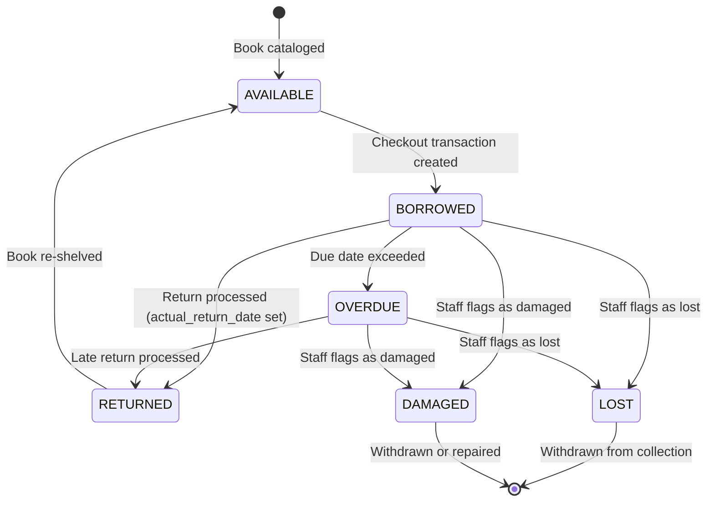

# LIBRAS — Entity-Relationship Diagram (ERD) Specification

**System Name:** Library Borrowing and Records Administration System (LIBRAS)
**Target Institution:** University of Makati Library Learning Commons (UMak LLC)
**Target Database Engine:** PostgreSQL (Relational)
**Document Version:** 1.0 — September 11, 2026
**Prepared by:** LIBRAS Development Team, BS Computer Science — University of Makati

---

## 1. Document Purpose

This document presents the formal Entity-Relationship Diagram (ERD) Specification for the LIBRAS database schema. It defines all entities, their attributes, primary and foreign keys, relationship cardinalities, and participation constraints that govern the PostgreSQL relational database underpinning the system's Flutter mobile application and React web dashboard.

> [!NOTE]
> This ERD conforms to **Third Normal Form (3NF)** and uses **Crow's Foot notation** for cardinality. All enumerated types are implemented as PostgreSQL `CHECK` constraints on `VARCHAR` columns for portability and explicit validation.

---

## 2. Entity-Relationship Diagram

```mermaid
erDiagram
    PATRON {
        SERIAL patron_id PK "Auto-generated surrogate key"
        VARCHAR id_number UK "Student or Employee ID"
        VARCHAR umak_email UK "Must end in @umak.edu.ph"
        VARCHAR first_name "Given name"
        VARCHAR middle_name "Nullable"
        VARCHAR last_name "Surname"
        VARCHAR college_department "College or department"
        VARCHAR academic_program "Course or program"
        VARCHAR contact_phone "Mobile number"
        VARCHAR patron_type "STUDENT | FACULTY | NTP"
        VARCHAR academic_status "ACTIVE | FLAGGED"
        VARCHAR clearance_status "CLEAR | ON_HOLD"
        VARCHAR barcode UK "Scannable digital ID barcode"
        TIMESTAMPTZ created_at "Record creation timestamp"
        TIMESTAMPTZ updated_at "Last modification timestamp"
    }

    GUEST {
        SERIAL guest_id PK "Auto-generated surrogate key"
        VARCHAR first_name "Given name"
        VARCHAR middle_name "Nullable"
        VARCHAR last_name "Surname"
        VARCHAR home_institution "Home university or organization"
        VARCHAR contact_number "Mobile number"
        VARCHAR email "Valid personal or institutional email"
        TEXT visit_purpose "Specific research purpose"
        VARCHAR visitor_pass_barcode UK "Temporary digital barcode"
        TIMESTAMPTZ pass_valid_from "Pass activation timestamp"
        TIMESTAMPTZ pass_valid_until "Pass expiration timestamp"
        TIMESTAMPTZ created_at "Record creation timestamp"
    }

    STAFF {
        SERIAL staff_id PK "Auto-generated surrogate key"
        VARCHAR employee_id UK "UMak Employee ID"
        VARCHAR first_name "Given name"
        VARCHAR middle_name "Nullable"
        VARCHAR last_name "Surname"
        VARCHAR umak_email UK "Institutional email"
        VARCHAR role "OIC_DIRECTOR | REFERENCE_LIBRARIAN | CATALOGING_LIBRARIAN | STUDENT_ASSISTANT"
        BOOLEAN is_active "Active employment flag"
        TIMESTAMPTZ created_at "Record creation timestamp"
        TIMESTAMPTZ updated_at "Last modification timestamp"
    }

    BOOK {
        VARCHAR accession_number PK "Unique barcode per physical copy"
        VARCHAR title "Full book title"
        VARCHAR isbn "ISBN-10 or ISBN-13"
        VARCHAR lc_call_number "Library of Congress call number"
        VARCHAR collection_category "Collection type or section"
        VARCHAR college_reference "Associated college"
        SMALLINT publication_year "Year of publication"
        VARCHAR physical_condition "GOOD | FAIR | POOR | DAMAGED"
        VARCHAR availability_status "AVAILABLE | BORROWED | RETURNED | OVERDUE | LOST | DAMAGED"
        TIMESTAMPTZ created_at "Record creation timestamp"
        TIMESTAMPTZ updated_at "Last modification timestamp"
    }

    BOOK_AUTHOR {
        SERIAL book_author_id PK "Auto-generated surrogate key"
        VARCHAR accession_number FK "FK to BOOK"
        VARCHAR author_name "Full name of author"
        SMALLINT author_order "Display order for multi-author works"
    }

    BORROWING_TRANSACTION {
        SERIAL transaction_id PK "Auto-generated surrogate key"
        INTEGER patron_id FK "FK to PATRON"
        VARCHAR accession_number FK "FK to BOOK"
        INTEGER staff_id FK "FK to STAFF — processing librarian"
        DATE borrow_date "Date book was checked out"
        DATE due_date "Calculated return deadline"
        DATE actual_return_date "Nullable — populated on return"
        VARCHAR transaction_status "ACTIVE | RETURNED | OVERDUE | LOST_DAMAGED"
        TIMESTAMPTZ created_at "Record creation timestamp"
        TIMESTAMPTZ updated_at "Last modification timestamp"
    }

    PENALTY {
        SERIAL penalty_id PK "Auto-generated surrogate key"
        INTEGER patron_id FK "FK to PATRON"
        INTEGER transaction_id FK "FK to BORROWING_TRANSACTION"
        VARCHAR penalty_type "OVERDUE_FINE | LOST_ITEM | DAMAGED_ITEM | DISCIPLINARY"
        NUMERIC amount "Monetary fine in PHP"
        VARCHAR settlement_status "UNPAID | PAID | WAIVED"
        DATE date_issued "Date penalty was assessed"
        DATE date_resolved "Nullable — date penalty was settled"
        TIMESTAMPTZ created_at "Record creation timestamp"
        TIMESTAMPTZ updated_at "Last modification timestamp"
    }

    VISIT_LOG {
        SERIAL visit_id PK "Auto-generated surrogate key"
        INTEGER patron_id FK "Nullable FK to PATRON"
        INTEGER guest_id FK "Nullable FK to GUEST"
        VARCHAR visitor_type "STUDENT | FACULTY | NTP | GUEST"
        VARCHAR host_unit_college "Library section or college visited"
        VARCHAR visit_purpose "Purpose of the visit"
        TIMESTAMPTZ check_in_timestamp "Exact check-in time"
        INTEGER checked_in_by_staff_id FK "FK to STAFF"
    }

    REFERENCE_INQUIRY {
        SERIAL inquiry_id PK "Auto-generated surrogate key"
        VARCHAR inquirer_name "Full name of patron or guest"
        VARCHAR inquirer_email "Contact email for follow-up"
        VARCHAR subject_topic "Research subject or reference topic"
        TIMESTAMPTZ date_submitted "Submission timestamp"
        INTEGER assigned_librarian_id FK "Nullable FK to STAFF"
        VARCHAR inquiry_status "OPEN | IN_PROGRESS | RESOLVED"
        TIMESTAMPTZ created_at "Record creation timestamp"
        TIMESTAMPTZ updated_at "Last modification timestamp"
    }

    PATRON ||--o{ BORROWING_TRANSACTION : "borrows"
    BOOK ||--o{ BORROWING_TRANSACTION : "is checked out in"
    STAFF ||--o{ BORROWING_TRANSACTION : "processes"

    BOOK ||--o{ BOOK_AUTHOR : "is written by"

    PATRON ||--o{ PENALTY : "incurs"
    BORROWING_TRANSACTION ||--o{ PENALTY : "generates"

    PATRON ||--o{ VISIT_LOG : "checks in as"
    GUEST ||--o{ VISIT_LOG : "checks in as"
    STAFF ||--o{ VISIT_LOG : "logs entry for"

    STAFF ||--o{ REFERENCE_INQUIRY : "is assigned to"
```



---

## 3. Entity Summary Table

| # | Entity Name | Table Name | Primary Key | Description |
|---|---|---|---|---|
| 1 | Patron | `patron` | `patron_id` (SERIAL) | Internal library users: Students, Faculty, and Non-Teaching Personnel with UMak credentials. |
| 2 | Guest | `guest` | `guest_id` (SERIAL) | External visitors, researchers, alumni, and non-UMak personnel with temporary access. |
| 3 | Staff | `staff` | `staff_id` (SERIAL) | Library employees with role-based access: OIC-Director, Librarians, Student Assistants. |
| 4 | Book | `book` | `accession_number` (VARCHAR) | Individual physical book copies tracked at the accession/barcode level. |
| 5 | Book Author | `book_author` | `book_author_id` (SERIAL) | Author attribution records supporting multi-author works per accession copy. |
| 6 | Borrowing Transaction | `borrowing_transaction` | `transaction_id` (SERIAL) | Circulation records capturing the full lifecycle from checkout through return. |
| 7 | Penalty | `penalty` | `penalty_id` (SERIAL) | Monetary fines and disciplinary penalties linked to overdue, lost, or damaged items. |
| 8 | Visit Log | `visit_log` | `visit_id` (SERIAL) | Foot traffic and attendance records for both patrons and guests. |
| 9 | Reference Inquiry | `reference_inquiry` | `inquiry_id` (SERIAL) | "Ask-a-Librarian" service tickets for scholarly reference requests and LLC forms. |

**Total Entities: 9** · **Total Relationships: 10**

---

## 4. Relationship Matrix & Cardinality

| # | Parent Entity | Child Entity | Cardinality | Participation | FK Column(s) | Business Rule |
|---|---|---|---|---|---|---|
| R1 | PATRON | BORROWING_TRANSACTION | 1 : 0..* | Mandatory–Optional | `patron_id` | A patron may borrow zero or more books. Every transaction must reference exactly one patron. |
| R2 | BOOK | BORROWING_TRANSACTION | 1 : 0..* | Mandatory–Optional | `accession_number` | A book copy may appear in zero or more transactions over time. Every transaction must reference exactly one book copy. |
| R3 | STAFF | BORROWING_TRANSACTION | 1 : 0..* | Mandatory–Optional | `staff_id` | A staff member processes zero or more transactions. Every transaction must be processed by exactly one staff member. |
| R4 | BOOK | BOOK_AUTHOR | 1 : 1..* | Mandatory–Mandatory | `accession_number` | Every book must have at least one author. An author record belongs to exactly one book copy. |
| R5 | PATRON | PENALTY | 1 : 0..* | Mandatory–Optional | `patron_id` | A patron may incur zero or more penalties. Every penalty must reference exactly one patron. |
| R6 | BORROWING_TRANSACTION | PENALTY | 1 : 0..* | Mandatory–Optional | `transaction_id` | A transaction may generate zero or more penalties (e.g., overdue + lost). Every penalty must reference exactly one transaction. |
| R7 | PATRON | VISIT_LOG | 1 : 0..* | Optional–Optional | `patron_id` (nullable) | An enrolled patron may have zero or more visit log entries. |
| R8 | GUEST | VISIT_LOG | 1 : 0..* | Optional–Optional | `guest_id` (nullable) | A guest may have zero or more visit log entries. |
| R9 | STAFF | VISIT_LOG | 1 : 0..* | Mandatory–Optional | `checked_in_by_staff_id` | A staff member may log zero or more visitor entries. Every visit must be logged by exactly one staff member. |
| R10 | STAFF | REFERENCE_INQUIRY | 1 : 0..* | Optional–Optional | `assigned_librarian_id` (nullable) | A librarian may be assigned to zero or more inquiries. An inquiry may optionally be assigned to a librarian. |

---

## 5. Polymorphic Visitor Resolution (VISIT_LOG)

The `visit_log` entity records foot traffic for both **internal patrons** (Students, Faculty, NTP) and **external guests**. This is resolved through a **dual-nullable foreign key pattern** with an exclusive-arc constraint:

```sql
-- Exactly one of patron_id or guest_id must be non-NULL
ALTER TABLE visit_log
ADD CONSTRAINT chk_visitor_exclusivity
CHECK (
    (patron_id IS NOT NULL AND guest_id IS NULL)
    OR
    (patron_id IS NULL AND guest_id IS NOT NULL)
);
```

The `visitor_type` discriminator column (`STUDENT`, `FACULTY`, `NTP`, `GUEST`) provides denormalized classification for fast filtering and reporting without requiring a JOIN to determine the visitor category.

---

## 6. Key Business Logic Constraints

### 6.1 Graduation Clearance Automation
When a `borrowing_transaction` status transitions to `OVERDUE` or `LOST_DAMAGED`, the system **automatically** sets the associated patron's `clearance_status` to `ON_HOLD`. Clearance is restored to `CLEAR` only when all outstanding penalties reach `PAID` or `WAIVED` status and no active overdue transactions remain.

### 6.2 Book Availability State Machine



### 6.3 Enforced Domain Constraints

| Constraint | Table | Column | Rule |
|---|---|---|---|
| Email Domain | `patron` | `umak_email` | Must match pattern `%@umak.edu.ph` |
| Email Domain | `staff` | `umak_email` | Must match pattern `%@umak.edu.ph` |
| Patron Type | `patron` | `patron_type` | `IN ('STUDENT', 'FACULTY', 'NTP')` |
| Academic Status | `patron` | `academic_status` | `IN ('ACTIVE', 'FLAGGED')` |
| Clearance Status | `patron` | `clearance_status` | `IN ('CLEAR', 'ON_HOLD')` |
| Staff Role | `staff` | `role` | `IN ('OIC_DIRECTOR', 'REFERENCE_LIBRARIAN', 'CATALOGING_LIBRARIAN', 'STUDENT_ASSISTANT')` |
| Book Condition | `book` | `physical_condition` | `IN ('GOOD', 'FAIR', 'POOR', 'DAMAGED')` |
| Availability | `book` | `availability_status` | `IN ('AVAILABLE', 'BORROWED', 'RETURNED', 'OVERDUE', 'LOST', 'DAMAGED')` |
| Transaction Status | `borrowing_transaction` | `transaction_status` | `IN ('ACTIVE', 'RETURNED', 'OVERDUE', 'LOST_DAMAGED')` |
| Penalty Type | `penalty` | `penalty_type` | `IN ('OVERDUE_FINE', 'LOST_ITEM', 'DAMAGED_ITEM', 'DISCIPLINARY')` |
| Settlement | `penalty` | `settlement_status` | `IN ('UNPAID', 'PAID', 'WAIVED')` |
| Visitor Type | `visit_log` | `visitor_type` | `IN ('STUDENT', 'FACULTY', 'NTP', 'GUEST')` |
| Inquiry Status | `reference_inquiry` | `inquiry_status` | `IN ('OPEN', 'IN_PROGRESS', 'RESOLVED')` |
| Guest Pass Validity | `guest` | `pass_valid_from`, `pass_valid_until` | `pass_valid_until > pass_valid_from` |
| Return Date Logic | `borrowing_transaction` | `actual_return_date` | Must be `NULL` while status = `ACTIVE`; must be ≥ `borrow_date` when populated |

---

## 7. Normalization Compliance

| Normal Form | Status | Justification |
|---|---|---|
| **1NF** | ✅ Satisfied | All columns contain atomic values. Multi-valued author data is decomposed into the `book_author` associative entity. |
| **2NF** | ✅ Satisfied | All non-key attributes are fully functionally dependent on their respective primary keys. No partial dependencies exist. |
| **3NF** | ✅ Satisfied | No transitive dependencies. The `visitor_type` column in `visit_log` is a controlled denormalization for reporting performance, documented as an intentional design decision. |

---

## 8. Index Strategy (Recommended)

| Table | Index Name | Column(s) | Type | Rationale |
|---|---|---|---|---|
| `patron` | `idx_patron_barcode` | `barcode` | UNIQUE B-Tree | Barcode scan lookup at circulation desk |
| `patron` | `idx_patron_id_number` | `id_number` | UNIQUE B-Tree | Manual fallback lookup by Student/Employee ID |
| `patron` | `idx_patron_clearance` | `clearance_status` | B-Tree | Graduation clearance batch queries |
| `guest` | `idx_guest_barcode` | `visitor_pass_barcode` | UNIQUE B-Tree | Guest barcode scan at entrance |
| `book` | `idx_book_title` | `title` | B-Tree | Catalog title search |
| `book` | `idx_book_isbn` | `isbn` | B-Tree | ISBN lookup |
| `book` | `idx_book_lc_call` | `lc_call_number` | B-Tree | LC Call Number search |
| `book` | `idx_book_status` | `availability_status` | B-Tree | Availability filtering |
| `borrowing_transaction` | `idx_bt_patron_status` | `patron_id, transaction_status` | Composite B-Tree | Active loans per patron |
| `borrowing_transaction` | `idx_bt_accession` | `accession_number` | B-Tree | Transaction lookup by book |
| `borrowing_transaction` | `idx_bt_due_date` | `due_date` | B-Tree | Overdue detection batch job |
| `penalty` | `idx_penalty_patron` | `patron_id` | B-Tree | Patron penalty history |
| `penalty` | `idx_penalty_unsettled` | `settlement_status` | Partial (WHERE ≠ 'PAID') | Outstanding penalty queries |
| `visit_log` | `idx_visit_checkin` | `check_in_timestamp` | B-Tree | Date-range attendance reports |

---

## 9. Revision History

| Version | Date | Author | Description |
|---|---|---|---|
| 1.0 | September 11, 2026 | LIBRAS Development Team | Initial ERD specification — 9 entities, 10 relationships, 3NF compliant |

---

*End of ERD Specification Document*
