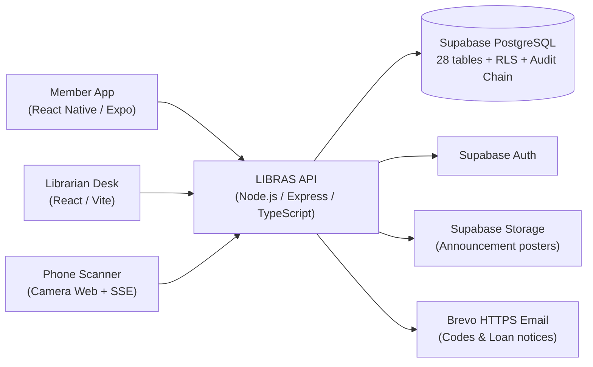

# LIBRAS

**Library Borrowing and Records Administration System** for the University of Makati.

[](https://github.com/necesario0/LIBRAS/actions/workflows/ci.yml)


LIBRAS replaces handwritten paper circulation slips with a mobile app for Members, a browser desk for Librarians, and a phone camera barcode scanner. One TypeScript API enforces search, priority Holds, rotating Digital IDs, Fines, and a tamper-evident audit log on top of PostgreSQL.

## Key capabilities

### Member mobile app (Android)
- **Typo-tolerant catalog search:** Search titles and authors with edit-distance matching, live suggestions, recent searches, sorting, and filters (Available now, Subject from LC call number, publication year, and latest edition).
- **Self-service borrowing flow:** Browse curated Home shelves, save Books, place and cancel Holds when no Copy is available, renew eligible Loans, and view live Clearance, Good standing, and Fine totals.
- **Rotating Digital ID:** Display a 12-digit Code 128 barcode (6 fixed Member digits plus a 6-digit HMAC-SHA-256 token rotating every 60 seconds) with automatic brightness boost and a countdown timer.
- **Notifications and account controls:** In-app Notification inbox (Hold ready, due tomorrow, overdue, Announcements), optional push notifications, sign out of all devices, and self-service account deletion once cleared.
- **Five Account Types:** UMAK Student, Faculty, NTP / Employee (7-day Loans, up to 3 Copies, 1 Renewal), and Visitor / Alumni (same-day in-library Loans).

### Librarian web desk and phone scanner
- **One-scan circulation:** Scan a Member's Digital ID to open a 10-minute Desk session showing their Account Type, open Loans, and computed Clearance, then scan Copy barcodes to confirm Loans.
- **Automatic returns, Fines, and Hold dispatch:** Scanning a Copy with no Member at the desk records the return, fixes any late Fine (`PHP 5/day`, capped at `PHP 300`), lets the Librarian settle Fines as `paid` or `waived`, and sets aside the Copy for the highest-priority waiting Hold.
- **Phone camera scanner:** Pair any smartphone browser at `/scan.html` with a 6-digit desk code to stream 1D barcode scans over Server-Sent Events without a dedicated USB scanner.
- **Announcements management:** Create, crop (2:1 banner), schedule, and end library Announcements shown on the Member Home screen.

### Algorithms and security
- **Bounded Levenshtein Trie search:** Flattened typed-array prefix tree with dynamic programming and branch-and-bound pruning (`k = 0` for 1-3 letters, `1` for 4-6, `2` for 7+). Exact up to `k` edits; measured `1.93 ms` p95, `937 queries/s`, and `4.4 MB` memory on 50,000 tokens (compared with `16.9%` recall for `pg_trgm` at threshold `0.3`).
- **Role-Weighted Priority Hold Dispatcher:** Orders Holds by `placed_at - role_weight` (Faculty `24 h`, NTP `12 h`, Student `0 h`), indexed on `(book_id, score, seq)` for `O(log K)` dispatch with `FOR UPDATE SKIP LOCKED` inside the return transaction. Bounded weights prevent starvation.
- **Defense in depth:** 18 PostgreSQL Row-Level Security (RLS) policies, API role gates, Zod request validation, parameterized SQL everywhere, bcrypt password hashing via Supabase Auth, rate-limited sign-in and scanner pairing, and an append-only SHA-256 hash-chained `audit_log` protected by database triggers and verified by `npm run audit:verify -w @libras/api`.

## Architecture



Clients never query PostgreSQL directly. All business rules, Digital ID secrets, Hold dispatch, catalog indexing, and audit writes live in the API, backed by PostgreSQL constraints and RLS.

## Repository layout

LIBRAS is a single TypeScript monorepo managed with npm workspaces.

| Path | Package | Description |
| --- | --- | --- |
| [`apps/api`](apps/api/README.md) | `@libras/api` | Express + TypeScript REST API, trie search index, circulation logic, audit chain, and sweep worker |
| [`apps/mobile`](apps/mobile/README.md) | `@libras/mobile` | React Native (Expo) Android app for Members |
| [`apps/web`](apps/web/README.md) | `@libras/web` | Vite + React Librarian desk (`/`) and phone camera scanner (`/scan.html`) |
| [`packages/shared`](packages/shared/README.md) | `@libras/shared` | Shared domain types, Zod schemas, policy helpers, and the Bounded Levenshtein Trie implementation |
| [`benchmarks`](benchmarks/README.md) | `libras-algorithm-benchmarks` | Reproducible search and Hold-dispatch benchmarks behind ADR 0001 |
| `supabase` | | Local Supabase config and 29 PostgreSQL migrations |
| `docs` | | Architecture Decision Records (`docs/adr/`), deployment guide, verification steps, and benchmark reports |

## Quick start

### Prerequisites

- **Node.js 22.18+** (CI uses Node 24 LTS; see `.node-version`). Node runs TypeScript files directly with no build step.
- **Docker** running locally (for the Supabase PostgreSQL, Auth, and Storage containers).

### Run locally

```bash
git clone https://github.com/necesario0/LIBRAS.git
cd LIBRAS
npm ci
npm run dev
```

`npm run dev` starts the local Supabase stack (first run downloads Docker images) and launches the API on `http://localhost:3000`. No `.env` file is required locally because workspace scripts load local Supabase keys automatically via `apps/api/scripts/with-local-supabase.ts`.

Verify the API is healthy:

```bash
curl http://localhost:3000/health
```

Seed the local Librarian account (`librarian@libras.test`) and a synthetic 45,460-Book catalog (or place the private UMak accession workbook at `data/library-catalog.xlsx` and run `npm run seed`):

```bash
npm run seed -- --sample-catalog
```

Start the Librarian web desk in a second terminal (`http://localhost:5173`):

```bash
npm run dev -w @libras/web
```

### Common commands

| Command | Purpose |
| --- | --- |
| `npm run dev` | Start local Supabase and the API in watch mode |
| `npm run db:start` / `db:stop` / `db:reset` | Manage local Supabase containers and replay `supabase/migrations/` |
| `npm run seed -- --sample-catalog` | Seed the demo Librarian, Loan Policies, and synthetic catalog |
| `npm run labels -- --title "algorithms"` | Generate printable Code 128 Copy labels (`copy-labels.html`) |
| `npm run audit:verify -w @libras/api` | Recompute and verify the SHA-256 audit log hash chain |
| `npm run build:apk -w @libras/mobile` | Build a local Android release APK (`apps/mobile/build/libras.apk`) |

> **Note on private catalog data:** Never commit `.xlsx`, `.xls`, or `.csv` accession lists. `/data/` and spreadsheet extensions are gitignored because the real library workbook contains acquisition costs and staff metadata.

## Testing and code quality

API tests run real HTTP requests against the local Supabase PostgreSQL instance (`npm run db:start` first).

```bash
npm run check            # typecheck, lint, and all workspace tests (same as CI)
npm test                 # API, shared, and benchmark tests (Node test runner)
npm run test:e2e         # Playwright desk end-to-end tests in Chrome
npm run typecheck        # TypeScript check across all workspaces
npm run lint             # ESLint, Stylelint, design token rules, clock rule, and glossary check
```

Every pull request runs `.github/workflows/ci.yml`: typecheck, lint, full test suite against PostgreSQL, **Gitleaks** secret scanning over git history, and **CodeQL** static security analysis. Local pre-push hooks (`.githooks`) run typecheck, lint, and Gitleaks before pushing.

## Deployment

LIBRAS deploys on Supabase (PostgreSQL, Auth, Storage), Render (API web service and desk static site via `render.yaml`), and Brevo (HTTPS transactional email). See the full operational guide in [`docs/deployment.md`](docs/deployment.md) and the verification playbook in [`docs/hosted-verification.md`](docs/hosted-verification.md).

## Documentation

- **Domain vocabulary:** [`GLOSSARY.md`](GLOSSARY.md) (enforced in code by `scripts/check-glossary.mjs`)
- **Architecture Decision Records:** [`docs/adr/`](docs/adr/) (12 ADRs covering search and Hold algorithms, React Native, Supabase/Render, Code 128 Digital IDs, SSE phone scanning, Pickup Window expiry, Fines, account deletion, and notifications)
- **Algorithm benchmarks:** [`docs/algorithm-benchmark-report.md`](docs/algorithm-benchmark-report.md) and [`benchmarks/README.md`](benchmarks/README.md)
- **Push notifications setup:** [`docs/push-notifications.md`](docs/push-notifications.md)
- **Deployment guide:** [`docs/deployment.md`](docs/deployment.md)

## Current scope and roadmap

| Area | Status | Notes |
| --- | --- | --- |
| Member Android app & Librarian circulation desk | Built | Search, shelves, Holds, Loans, Renewals, Fines, Clearance, Digital ID, phone scanner, Announcements, Notifications |
| Core algorithms (hashing, RBAC/RLS, audit chain, B-Tree indexes, trie search, priority Hold queue) | Built | Copy lifecycle FSM is partial (`damaged`, `missing`, and `inspected` states are planned) |
| Super Admin dashboard & Librarian reporting tools | Planned | Role/Admin management, audit trail UI viewer, transaction filters, PDF/Excel reports |
| Predictive algorithms & offline desk cache | Planned | Semantic search, overdue-risk prediction, congestion forecasting, offline desk buffer, automated PITR backups |

## Team

Built by **Team Synto Singko** (III-BCSAD, College of Computing and Information Sciences, University of Makati):

- **Rosalan** - Project Manager / Researcher
- **Necesario** - Lead Developer / Algorithms
- **Saavedra** - Developer, UI/UX, Simulation
- **Baldonado** - UI/UX, Tester
- **Urdaneta** - Researcher, Tester
