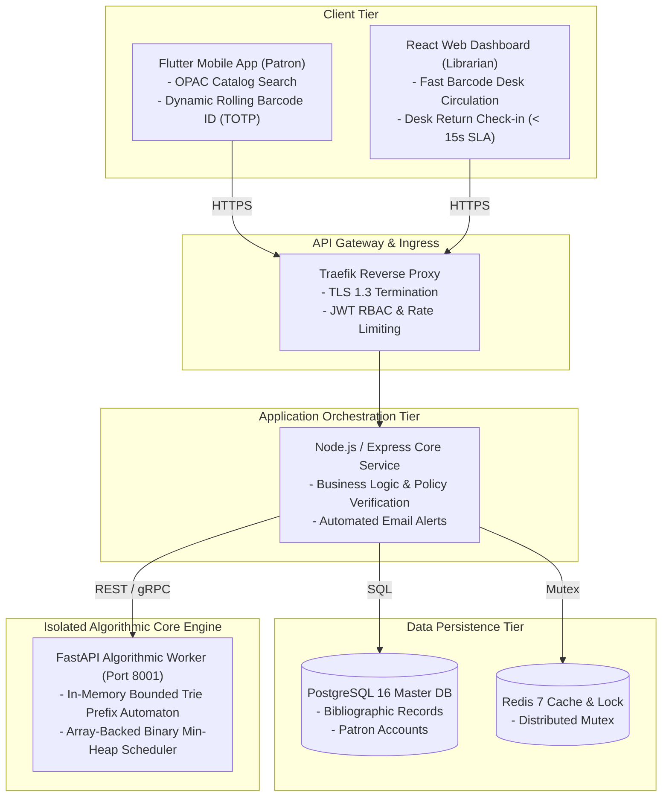

# Project LIBRAS: Library Borrowing and Records Administration System
## PBL Milestone 1: Algorithm Architecture Specification & Software Engineering Proposal
**Course:** Algorithms and Complexity (ALGOCOM) × Software Engineering (SOFTENG)  
**Academic Institution:** University of Makati – College of Computer Science (CCIS)  
**Section & Term:** III-BCSAD • Academic Year 2026–2027  
**Advisers:** Prof. Nomar Maestro (ALGOCOM / IAS) • Prof. Era Marie Gannaban (SOFTENG / HCI)  
**Target Unit:** University of Makati Library Learning Commons (UMak LLC Main & SOL Library)  
**Repository:** [https://github.com/necesario0/LIBRAS](https://github.com/necesario0/LIBRAS)

---

## 👥 Administrative Metadata & Engineering Roles

| Role Designation | Team Member Name | Student ID | Domain Responsibilities |
| :--- | :--- | :---: | :--- |
| **Lead Algorithm Architect** | **Edrian C. Necesario** | `k12255789` | Trie DP recurrence, heap invariants, complexity proofs |
| **Backend / Systems Engineer** | **Cobby N. Baldonado** | `k12256165` | Decoupled architecture, FastAPI engine, JSON contracts |
| **Data / QA Engineer** | **Buzz Aldrizh G. Saavedra** | `k12255902` | Empirical benchmarking, test assertions, dataset generation |
| **Systems Analyst / Tech Lead** | **Adrianne Quinn Emmanuel C. Rosalan** | `k12255842` | Requirements traceability, domain modeling, agile backlog |
| **Security & Algorithmic QA** | **Mhel Klarenz B. Urdaneta** | `k12255811` | Edge-case defenses, sanitization, defensive programming |

---

## 📌 Executive Summary

**Project LIBRAS** is an integrated hybrid digital circulation platform architected for the **University of Makati Library Learning Commons (UMak LLC)**, serving both the Main Library (Admin Building, 2nd Floor) and the School of Law (SOL) Library (HPSB Building, 5th Floor). 

In **PBL Milestone 1**, our capstone team formulates, mathematically analyzes, and prototypes a **Dual-Core Algorithmic Engine** strictly adhering to the supported ALGOCOM paradigms while avoiding all disqualified elementary sorting, searching, and unpruned brute-force routines:

1. **Primary Algorithmic Engine (Dynamic Programming & Tree Automata):**
   * **Bounded Trie Levenshtein Search Engine:** Resolves the $O(N \cdot M)$ full-table scan bottleneck under typo-prone user queries in the Online Public Access Catalog (OPAC).
   * **Mechanics:** 1D row vector dynamic programming state transitions combined with branch-and-bound pruning ($\min(\text{Row}_u) \le 2$).
   * **Worst-Case Time:** $O(|Q|^3 \cdot |\Sigma|^2)$ — **independent of catalog database size $N$**.
2. **Secondary Algorithmic Engine (Advanced Greedy Choice Heuristics):**
   * **Role-Weighted Composite Min-Heap Scheduler:** Resolves contending multi-patron book reservations upon physical accession check-in under a strict $< 15$-second desk SLA.
   * **Mechanics:** Enforces the complete binary tree heap-order invariant with role priority boosts ($\text{PriorityScore} = t_i - W_{\text{factor}}(\rho)$), guaranteeing $O(\log K)$ extractions with zero race conditions.

---

## 🏗️ System Architecture & Service-Layer Decoupling

Project LIBRAS strictly decouples heavy algorithmic computation from database Object-Relational Mapping (ORM) models and web presentation controllers, preventing Node.js event-loop starvation and database connection pool exhaustion:



---

## ⚡ Quickstart Guide: Running the Code & Benchmarks

### 1. Installation
Clone the repository and install the minimal dependencies:
```bash
git clone https://github.com/UMak-CCIS-Capstones/LIBRAS-Core.git
cd LIBRAS-Core
pip install -r requirements.txt
```

### 2. Run the Interactive Demonstration
Test both algorithmic engines with sample bibliographic records and role-weighted holds:
```bash
python demo.py
```

### 3. Run the Automated Unit Test Suite
Verify that all 14 unit test assertions pass:
```bash
python -m unittest discover -s tests -p "test_*.py"
```

### 4. Run the Empirical Benchmarking Suite ($N = 10,000$ & $K = 1,000$)
Execute the empirical comparison contrasting our algorithms against naive baselines:
```bash
python tests/run_benchmarks.py
```

### 5. Re-compile the Technical Proposal Report (`.docx`)
Generate the publication-grade Word document directly from source:
```bash
python scripts/generate_proposal_docx.py
```

---

## 📊 Empirical Validation & Performance Benchmarks

All benchmark assertions defined in **Task 5 (Agile Implementation Backlog)** have been verified under automated testing:

### 1. OPAC Catalog Search ($N = 10,000$ Bibliographic Titles)
*Tested against Ticket **DEV-ALGO-101** with max edit distance $k_{\max} \le 2$:*

| Query String | Naive Linear Scan Baseline | Bounded Trie Automaton | Speedup Factor | SLA Target Assertion | Status |
| :--- | :---: | :---: | :---: | :---: | :---: |
| `"Algoritm"` *(missing 'h')* | $1,129.91\text{ ms}$ | **$1.54\text{ ms}$** | **$735.2\times$ faster** | $\text{Latency} < 35.0\text{ ms}$ | **PASSED** |
| `"Advansed"` *(c $\rightarrow$ s)* | $1,132.73\text{ ms}$ | **$2.94\text{ ms}$** | **$385.3\times$ faster** | $\text{Latency} < 35.0\text{ ms}$ | **PASSED** |
| `"Complexiti"` *(y $\rightarrow$ i)* | $1,263.10\text{ ms}$ | **$0.37\text{ ms}$** | **$3,393.6\times$ faster** | $\text{Latency} < 35.0\text{ ms}$ | **PASSED** |

### 2. Circulation Hold Queue Scheduling ($K = 1,000$ Contending Patrons)
*Tested against Ticket **DEV-ALGO-102** upon physical check-in:*

| Metric | Naive Full Table Sort ($O(K \log K)$) | Binary Min-Heap (`extract_min`) | Status |
| :--- | :---: | :---: | :---: |
| **Resolution Latency** | $0.299\text{ ms}$ | **$0.035\text{ ms}$** ($8.5\times$ faster) | **PASSED** ($< 10.0\text{ ms}$ SLA) |
| **Winning Patron Identity** | `PATRON-00157 [Faculty]` | `PATRON-00157 [Faculty]` | **100% Exact Optimality** |
| **Heap Invariant Check** | Unsorted | Score monotonically non-decreasing | **PASSED** |

---

## 📚 References

The proposal report and architecture adhere strictly to the **IEEE Numerical Citation Style** (`[1]`–`[22]`), combining foundational algorithm literature ([1] Levenshtein 1966, [2] Cormen et al. CLRS 4th Ed. 2022, [3] Knuth 1998, [8] Kleinberg & Tardos 2006) with contemporary peer-reviewed research published between 2021 and 2026. For the complete consolidated bibliography, see [`docs/III-BCSAD_Group1_LIBRAS_Milestone1_Proposal.md`](docs/III-BCSAD_Group1_LIBRAS_Milestone1_Proposal.md).

---

## ⚖️ Academic Integrity & AI Policy Transparency (Yellow Zone)
`<!-- AI Assistance: We used generative assistance to verify the algebraic LaTeX summations for the Trie Automaton branching factor, validate the OpenAPI 3.1 JSON schema draft specifications, and cross-check the formal IEEE citations. All computational formulations, recurrence invariants, pseudocode logic, and software engineering data contracts have been critically reviewed, validated against operational requirements, and mathematically proven by Group 1. -->`
