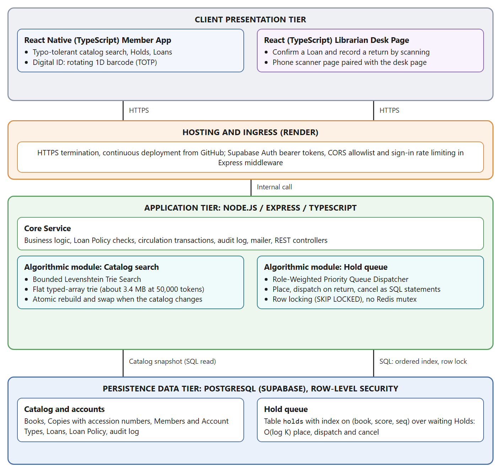

# LIBRAS Algorithm Design Document (Revised)

Project LIBRAS: Library Borrowing and Records Administration System

Revised after the Benchmarking Analysis review, against the system as built

Academic Course: Algorithms and Complexity (ALGOCOM) × Software Engineering (SOFTENG)

University of Makati • College of Computer Science (CCIS) • Academic Year 2026–2027

> **About this revision.** This document specifies the two algorithms of Project LIBRAS: their formal model, invariants, pseudocode, complexity, empirical selection, architecture and validation plan. This revision rewrites it against the code LIBRAS now ships and against the Revised Benchmarking Analysis, which answers the seven findings of the review of our first notebook. Every figure in Section 3 comes from that notebook, run top to bottom from one pinned commit. The changes are listed under "Revision History" and "Response to the Benchmarking Review" below. Supervised by Prof. Nomar Maestro (ALGOCOM) and Prof. Era Marie Gannaban (SOFTENG).

| Metadata Field | Project Team Specification |
| --- | --- |
| **Project Title** | **Project LIBRAS: Library Borrowing and Records Administration System (UMak LLC Main & SOL Library)** |
| **Team Name** | Group 1 (Synto Singko - LIBRAS) |
| **Section & Year** | III-BCSAD • Academic Year 2026–2027 |
| **Team Members & Engineering Roles** | Lead Algorithm Architect: Edrian C. Necesario (k12255958)<br>Backend / Systems Engineer: Cobby N. Baldonado (k12256165)<br>Data / QA Engineer: Buzz Aldrizh G. Saavedra (k12257228)<br>Systems Analyst / Technical Lead: Adrianne Quinn Emmanuel C. Rosalan (k12255842)<br>Security & Algorithmic QA Engineer: Mhel Klarenz B. Urdaneta (k12256252) |
| **Repository URL & Revision Date** | Repository: https://github.com/necesario0/LIBRAS (shipped code in `packages/`, `apps/` and `supabase/`; benchmarks in `benchmarks/`)<br>Revised Benchmarking Analysis: `benchmarks/LIBRAS_Benchmarking_Analysis.ipynb`, executed against commit `97d046449d70`; open in Colab: https://colab.research.google.com/github/necesario0/LIBRAS/blob/3becc9b3e4b9/benchmarks/LIBRAS_Benchmarking_Analysis.ipynb<br>Revision date: 26 November 2026 (first version: PBL Milestone 1, November 2026) |
| **[AI POLICY TRANSPARENCY: YELLOW ZONE CONFORMANCE]** | AI Assistance: We used generative assistance to verify the algebraic summations for the trie branching analysis, validate the OpenAPI 3.1 JSON schema draft specifications, and cross-check the formal IEEE citations. All computational formulations, recurrence invariants, pseudocode logic, and software engineering data contracts have been critically reviewed, validated against operational requirements, and mathematically proven by Group 1.<br>Generative assistance (Claude, Anthropic) was also used to write and run the benchmark code, to analyze its results, to draft parts of the algorithm analysis, and, for this revision, to rework the benchmarks after the review and to update this document against the shipped code. Group 1 reviewed the derivations and results and remains responsible for their accuracy. |

## Algorithms at a Glance

Project LIBRAS uses two algorithms, selected by comparing them against alternatives on the same data, queries and machine (Section 3.5). Both are built and running in the application.

| Role | Algorithm | Technique | Where it runs |
| --- | --- | --- | --- |
| Catalog search | **Bounded Levenshtein Trie Search** | Dynamic programming over a trie with branch-and-bound pruning, stored as flat typed arrays | `packages/shared/src/search/flat-trie.ts`, `catalog-index.ts`; served by `GET /catalog/search` |
| Hold dispatch | **Role-Weighted Priority Queue Dispatcher** | Greedy minimum-score selection from a partial B-Tree index in PostgreSQL, `FOR UPDATE SKIP LOCKED` | `apps/api/src/holds/dispatch.ts`, `priority.ts`; `supabase/migrations/20261112200000_holds.sql`; runs inside `POST /desk/returns` and the Pickup Window sweep |

## Revision History

| Version | Date | Changes |
| --- | --- | --- |
| 1.0 | November 2026 | PBL Milestone 1 submission: model, pseudocode, complexity, prototype benchmarks. |
| 2.0 | 26 November 2026 | Revised against the shipped code and the Revised Benchmarking Analysis: new measurements (median of 5 or 7 trials with IQR) in Sections 2.1, 3.2 to 3.5; the in-memory reference queue is now the indexed binary heap with O(log K) cancellation (Algorithm 2b); the concurrency semantics of `SKIP LOCKED` are stated and measured (Section 2.4); the worst-case bound separates expanded from visited nodes (Section 3.1); the first version's overstated figures are corrected; two gaps of the shipped search policy are recorded with their remedies (Section 6.2); dispatch on return and Pickup Window expiry, which were being built at version 1.0, are now built and tested. |

## Response to the Benchmarking Review

The review of our first notebook found seven issues. Each was fixed in the notebook and carried into this document.

| # | Finding | What changed in the benchmarks | What changed in this document |
| --- | --- | --- | --- |
| 1 | Outputs did not match the execution (timestamps after the run, a hard-coded Windows/Docker sentence in a Linux run, empty execution counts) | The notebook was restarted and run top to bottom in one session; every results file records its time, machine and benchmark commit; the PostgreSQL environment is read from the server at run time; a final cell checks that every results file came from that run and from clean, committed code. | Section 3.5 cites only figures from that run, with the commit. |
| 2 | The chosen in-memory heap cancels in O(K): 232 ns to 22,313 ns per operation from K = 5,000 to 50,000 | The indexed binary heap (O(log K) cancel) is now the marked choice; the shipped PostgreSQL queue's cancel is measured at K = 5,000 and 50,000. | Algorithm 2b is the indexed heap with `Cancel`; Section 3.1 gives its bounds; no cap on K is needed. |
| 3 | `SKIP LOCKED` can serve a lower-priority Hold first under concurrency; never measured | New experiment with 50 concurrent dispatchers on one title: clean commits, 10% rollbacks, and clients that lock the top Hold and roll back; Kendall's tau, rank displacement and left-behind Holds; against a strict per-title advisory lock. | Section 2.4 states the guarantee precisely; Section 3.5 reports the measurements; the advisory lock is the documented option for strict order. |
| 4 | The Map-based trie was marked as the choice; milestone claims overstated (about 40 node visits, 18.5 MB, "independent of N") | The shipped flat trie (`libras-flat-trie`) and its prototype are marked; the claims check compares each first-version figure with a measurement and with the revised claim, including 200,000 tokens (50,000 titles x 4 tokens). | Sections 3.1 to 3.4 use the measured figures; Section 3.2 states that cost grows with N below the worst-case ceiling. |
| 5 | Bound notation mixed visited nodes with edge probes | The worst-case check counts expanded nodes and visited nodes separately, up to m = 40 for an alphabet of 2, with the log-log slope. | Section 3.1 states both bounds and the measured ratios. |
| 6 | Single-run percentiles with non-monotonic jumps; SymSpell skipped without a reason | Every benchmark runs 5 (search, PostgreSQL) or 7 (queues) independent trials with shuffled order and reports the median and IQR; SymSpell is skipped by a stated memory-budget rule with its projected size. | All tables in Section 3.5 are medians with IQR. |
| 7 | Black-box execution, no dataset inspection, no failure breakdown, no related work | The notebook pins the commit and the Node.js version, shows the algorithms' source, inspects the datasets before timing, breaks failures down by edit type, distance and length with concrete missed queries, and adds related work. | Section 3.5 includes the failure-mode results; the references add the works the notebook cites. |

## Task 1: Computational Problem Modeling & Formal Mathematical Formulation

### 1.1 Problem Statement & Real-World Domain Operational Context

Modern academic libraries operate as high-density information discovery and resource sharing environments. At the University of Makati Library Learning Commons (UMak LLC) - which encompasses both the Main Library (Admin Building, 2nd Floor) and the School of Law (SOL) Library (HPSB Building, 5th Floor) - circulation management historically relied on manual ledger recording and unindexed desktop database lookups. This legacy manual process consumed 4 minutes and 10 seconds per checkout and frequently resulted in severe queue gridlock. Under the newly specified operational Service Level Agreements (SLAs) defined in the LIBRAS Requirements Engineering Specification (SRS v2.12.10.2026), checkout operations must execute in under 30 seconds, routine book returns must complete in under 15 seconds, and catalog search results must be delivered within 1.0 second under 50 concurrent users.

Throughout this document, a **Member** is a person with a library account, and every Member has one **Account Type**: UMAK Student, Faculty, NTP / Employee, Visitor or Alumni. A **Book** is a title and edition in the catalog, and a **Copy** is one physical item of a Book with its own accession number and barcode. A **Hold** is a Member's place in the queue for a Book that has no available Copy.

Within this operational scope, two severe computational bottlenecks arise that cannot be resolved through trivial database queries or elementary routines without violating production SLAs:

1. **Typographic Query Degradation in Catalog Search (OPAC):** Members regularly search for specialized academic textbooks and author surnames with typographic errors, transposition mistakes, or partial phonetic spellings. Standard relational database wildcard queries (e.g., SQL `ILIKE '%term%'`) are substring matches, so they have no typo tolerance at all: in the benchmark of Section 3.5 they returned only 3.7% of the words within two edits of the query, while still scanning every row. Exact fuzzy evaluation without an index scales at O(N · M · |Q|) for N records with average title length M, which keeps every query proportional to catalog size and exhausts server worker pools under multi-user bursts.
2. **Hold Contention & Dispatch under High-Volume Book Returns:** High-demand curriculum textbooks accumulate long queues of Holds. When a Copy is returned at the desk (demanding an immediate transaction completion in under 15 seconds), the circulation system must instantaneously resolve the single highest-priority Member entitled to that Copy without race conditions, deadlocks, or unfair starvation between Faculty and UMAK Students.

Treating these computational challenges as trivial SQL database queries fails to provide deterministic latency bounds and leads to thread pool starvation. Therefore, Project LIBRAS models these challenges as two coupled mathematical optimization problems: (a) an approximate string matching problem solved by branch-and-bound search over a trie, and (b) a role-weighted priority scheduling optimization problem solved with an ordered priority queue.

### 1.2 Formal Mathematical Specification

#### 1.2.1 Input Parameters (I)

The computational input space I is partitioned into the bibliographic lexicon and the pool of waiting Holds.

**1. Catalog Lexicon & Query Input:**

- Let Σ be the finite alphabet of normalized catalog text: letters and digits, in lowercase with accents removed (in practice the 26 Latin letters and 10 digits, so |Σ| is about 36).
- Let D = {w_1, w_2, ..., w_N} be the lexicon: the distinct words of all Book titles and author names, where N = |D| (about 50,000 at the benchmark scale).
- For each word w in D, let P(w) be its posting list: the set of Books whose title or authors contain w.
- Let I be the identifier table: a map from each ISBN, accession number and Library of Congress (LC) call number, reduced to its letters and digits, to the Books that carry it. Identifiers are not part of D.
- Let Q ∈ Σ* be the Member's query string, and let q^1, q^2, ..., q^p be the distinct words of Q after the same normalization. Let m = |q| denote the length of one query word.
- Let k(q) ∈ {0, 1, 2} be the edit distance bound of a query word (bounded Levenshtein radius): k(q) = 0 when |q| ≤ 3 or q contains a digit, k(q) = 1 when 4 ≤ |q| ≤ 6, and k(q) = 2 when |q| ≥ 7. The maximum radius is k_max = 2.

**2. Pool of Waiting Holds:**

- Let R = {r_1, r_2, ..., r_K} be the set of waiting Holds on one Book b, where K = |R| denotes the number of contending Members (K ≤ 5,000).
- Each Hold r_i is a structured 5-tuple: r_i = ⟨u_i, t_i, ρ_i, b, s_i⟩, where u_i is the unique Member identifier, t_i is the arrival time of the Hold, ρ_i ∈ {Faculty, NTP / Employee, UMAK Student} is the Member's Account Type, b is the Book, and s_i is a unique arrival sequence number.
- Visitor and Alumni Members may borrow only for same-day use inside the library and cannot place a Hold, so they never appear in R.

#### 1.2.2 Boundary Conditions & Constraints (C)

The operational boundaries and computational invariants C are defined as follows:

- **Query Boundedness:** 1 ≤ |Q| ≤ 100 characters after trimming. An empty query or one longer than 100 characters is rejected at ingress with a 400 response, not truncated, which bounds the work of one request and prevents algorithmic denial-of-service.
- **Metric Boundedness:** The edit distance function d_Lev(q, w) must satisfy the non-negativity, identity of indiscernibles, symmetry, and triangle inequality metric axioms: d_Lev(q, w) ≤ d_Lev(q, v) + d_Lev(v, w) for all q, v, w ∈ Σ* [1], [9].
- **Search Radius Cutoff:** Only lexicon words satisfying d_Lev(q, w) ≤ k(q) are admitted as matches of the query word q, and k(q) ≤ k_max = 2.
- **Conjunctive Matching:** A Book matches the query only when every query word matches at least one word of that Book.
- **Identifier Exactness:** When the query, reduced to its letters and digits, equals an entry of the identifier table I, the Books of that entry are the whole answer. No fuzzy match is added, so an identifier that is one character off finds nothing instead of a look-alike.
- **Arrival Order:** The arrival time t_i is taken from the server clock when the Hold is placed, never from the client. The sequence numbers are strictly increasing, s_1 < s_2 < ... < s_K, so two Holds with equal scores are still totally ordered.
- **Role Weights:** To serve teaching needs first without starving students, the role weights W(ρ) are bounded constants: W(Faculty) = 86,400,000 ms (24-hour virtual arrival advance); W(NTP / Employee) = 43,200,000 ms (12-hour advance); W(UMAK Student) = 0 ms (pure FIFO).
- **Hold Eligibility:** A Hold is accepted only when the Member's Account Type can borrow and the Book has no available Copy. A Member has at most one active Hold per Book.
- **Non-Preemptive Allocation:** Once a Copy is set aside for the Member u* whose Hold was chosen, it stays set aside for the Pickup Window T_pickup, a stored library setting whose initial value is 24 hours (86,400,000 ms). When the Pickup Window passes unused, the Hold expires and the next waiting Hold is chosen for the same Copy [4].

#### 1.2.3 Objective Functions (f(x))

The dual algorithmic engines execute distinct formal optimization objectives.

**1. OPAC Catalog Approximate Match Optimization (Minimization Problem):**

```
For each query word q:
    M(q) = { w in D : d_Lev(q, w) <= k(q) }

A Book B matches Q when, for every query word q,
    some w in M(q) has B in P(w).

Dist(Q, B) = sum over query words q of
             min { d_Lev(q, w) : w in M(q) and B in P(w) }
```

The matching Books are returned in order of Dist(Q, B) ascending, so an exact match (distance 0) comes first. Books with equal distance are ordered by title.

**2. Hold Dispatch Optimization (Minimization / Priority Scheduling Problem):**

```
r* = arg min over r_i in R of ( PriorityScore(r_i), s_i )
where PriorityScore(r_i) = t_i - W(rho_i)
```

#### 1.2.4 Output Certificate (O)

The algorithms return deterministic, structured outputs O:

1. **Catalog Search Output (O_search):** The number of matching Books, `total`, and an ordered list of at most `limit` of them (default 20, maximum 50), B_1, B_2, ..., ordered such that Dist(Q, B_1) ≤ Dist(Q, B_2) ≤ .... Each Book carries its bibliographic fields and the number of its Copies that are available now, which is read from the database at query time and is not part of the index. The benchmark build of the search additionally reports the number of trie nodes visited and the execution time.
2. **Hold Dispatch Output (O_hold):** The chosen Hold r* changes from waiting to ready and records the Copy that is set aside for it, the time it was chosen and the end of its Pickup Window. The Copy's status becomes set aside. Both changes commit in the same transaction as the return, together with an entry in the append-only audit log, where each entry stores a SHA-256 hash that chains to the previous entry. After the commit the Member is told by email. The dispatch guarantees that no Hold is chosen twice and that a Copy is set aside for at most one Hold.

## Task 2: Algorithmic Paradigm Selection & Logic Specification

### 2.1 Strategy Specification Schema

The architecture keeps the dual-engine design. Catalog search uses dynamic programming and branch-and-bound over a trie. Hold dispatch uses a greedy priority queue, ordered by an index in PostgreSQL.

| Schema field | Specification |
| --- | --- |
| Algorithm names | (1) Bounded Levenshtein Trie Search; (2) Role-Weighted Priority Queue Dispatcher |
| Design paradigms | Dynamic programming (one memoized DP row per trie node); branch and bound (prune a subtree when every cell of its DP row exceeds the radius); greedy choice (serve the minimum-score hold) |
| Foundational references | Levenshtein (1966) [1]; Wagner and Fischer (1974) [30]; Ukkonen (1985) [23]; Shang and Merrett (1996) [7]; Williams (1964) [33]; Cormen, Leiserson, Rivest and Stein (CLRS, 4th ed., 2022) [2]; Knuth (1998) [3]; Navarro (2001) [9]; Schulz and Mihov (2002) [10]; PostgreSQL 16 documentation [28] |
| Baselines compared (search) | SQL `ILIKE '%term%'`; PostgreSQL `levenshtein_less_equal` scan; PostgreSQL `pg_trgm` GIN index; linear scan with cutoff DP; BK-tree; SymSpell; bigram inverted index; trie with per-node objects |
| Baselines compared (queue) | Unsorted scan; sorted array; binary heap (with and without an id index); 4-ary heap; binary heap with lazy deletion; pairing heap; PostgreSQL indexed query |
| Computational justification | The shipped flat trie answered 50,000-token queries at k = 2 with p95 1.40 ms and 1,188 queries/s in 3.4 MB, the fastest exact option within the memory rule (Section 3.5). The PostgreSQL queue dispatched at p95 3.58 ms against a 10 ms limit, in the same order as the reference heap, cancelled in O(log K) at 50,000 Holds, and never served a Hold twice under 50 concurrent clients. |
| Invariants | Pruning lemma (Section 2.2); queue-order invariant (Section 2.2) |

### 2.2 Mathematical Invariants and Recurrence Relations

**Recurrence (edit distance matrix).** Let `D(i, j)` be the Levenshtein distance between the first `i` letters of the query `Q` and the first `j` letters of a word `w`. Then `D(i, 0) = i`, `D(0, j) = j`, and for `i, j >= 1`: `D(i, j) = D(i-1, j-1)` if `q_i = w_j`, otherwise `D(i, j) = 1 + min( D(i-1, j), D(i, j-1), D(i-1, j-1) )`, corresponding to deletion, insertion and substitution.

**Recurrence (edit distance row).** The trie search computes one column of this matrix per trie node, which is stored as a row of `m + 1` cells. Let `Q = q_1 ... q_m` be the query and let `u` be the string spelled by a trie node, whose last letter is `a`. Let `R_u` be the DP row of `u`, with cells `R_u[0..m]`, where `R_u[c]` is the Levenshtein distance between `u` and the prefix `q_1 ... q_c`. For a child node `v` of `u` reached by letter `a`:

```
R_v[0] = R_u[0] + 1
R_v[c] = min( R_u[c-1] + (0 if q_c = a else 1),   // match or substitute
              R_u[c]   + 1,                       // delete a from the word
              R_v[c-1] + 1 )                      // insert q_c into the word
```

The row of the root is `R_root[c] = c`. The distance between the query and the word spelled at a node is the last cell, `R_v[m]`.

**Lemma 1 (monotone row minimum).** For every child `v` of `u`, `min(R_v) >= min(R_u)`.

*Proof.* By induction on `c`. `R_v[0] = R_u[0] + 1 >= min(R_u)`. Assume `R_v[c-1] >= min(R_u)`. Each of the three terms defining `R_v[c]` is at least `min(R_u)`: the first two are `R_u` cells plus a non-negative amount, and the third is `R_v[c-1] + 1`. Hence `R_v[c] >= min(R_u)`. QED.

**Lemma 2 (pruning is safe).** If `min(R_u) > k`, then every word in the subtree of `u` has edit distance greater than `k` from the query.

*Proof.* By Lemma 1, the row minimum never decreases along a path from `u` to a descendant `w`, so `min(R_w) > k`. In particular the last cell satisfies `R_w[m] >= min(R_w) > k`. QED.

Consequence: the search returns exactly the words within distance `k`, with no false negatives and no false positives. This was also verified by 29 automated benchmark tests, by the shipped package's own tests, and by zero mismatches against a brute-force reference in every benchmark query, for the shipped code and for every other candidate.

**Distance used.** `d_Lev` counts substitutions, insertions and deletions. An adjacent transposition ("teh" for "the") is two edits in this distance. Section 6.2 records what this means for short words and the planned change to optimal string alignment distance, in which a transposition is one edit [14].

**Observation (no pruning at shallow depth).** At depth `d`, `R[0] = d`, so `min(R) <= d`. Pruning therefore cannot occur at depth `d <= k`. For `k = 2`, every trie node at depth 1 or 2 is always expanded.

**Queue-order invariant.** Each hold `r` has a score `PriorityScore(r) = t_r - W(role_r)`, where the role weights `W` are as defined in Section 1.2.2 (Faculty 86,400,000 ms; NTP / Employee 43,200,000 ms; UMAK Student 0). Ties are broken by arrival sequence `seq`. The queue of a Book is its waiting Holds ordered by the key `(score, seq)`, and dispatch always serves the waiting entry with the smallest key. Because `seq` is unique, the order is total and the winner is unique.

**Min-heap order invariant (in-memory reference implementation).** For the array-backed complete binary min-heap of Algorithm 2b, `(score, seq)(Parent(i)) <= (score, seq)(i)` for all `i` in `[1, K-1]`, the tree is complete (all levels full except possibly the last, filled left to right), and `pos[heap[i].hold_id] = i` for every `i`. The first part makes the root the minimum, so extraction returns the same winner as the indexed query; the last part lets a cancellation find its node in `O(1)`.

### 2.3 Structured Algorithmic Pseudocode

#### Algorithm 1: Bounded Levenshtein Trie Search (flat representation)

The trie is built once from the lexicon and is immutable. Nodes are numbered in breadth-first order, so the children of node `v` are the edges in the range `child_start[v]` to `child_start[v+1] - 1`.

```
structure FlatTrie:
    child_start : Int32[T + 1]   // T = number of trie nodes
    edge_char   : Uint16[E]      // letter on each edge (E = T - 1)
    edge_target : Int32[E]       // child node of each edge
    word_of     : String[T]      // word that ends at node v, or null
    max_depth   : Integer        // length of the longest word

function Search(trie, query, k) -> List<Match>:
    m = length(query)
    rows = Int32[(max_depth + 2) * (m + 1)]   // rows[d] = DP row, depth d
    for c in 0..m: rows[0][c] = c             // root row
    results = []
    if word_of[0] != null and rows[0][m] <= k:
        add (word_of[0], rows[0][m]) to results
    stack = [ (node = 0, next_edge = child_start[0]) ]
    while stack is not empty:
        frame = top(stack)
        if frame.next_edge == child_start[frame.node + 1]:
            pop(stack); continue
        e = frame.next_edge;  frame.next_edge = e + 1
        u = edge_target[e];   letter = edge_char[e]
        d = size(stack)                       // depth of the child u
        rows[d][0] = rows[d-1][0] + 1
        for c in 1..m:
            sub = rows[d-1][c-1] + (query[c-1] == letter ? 0 : 1)
            rows[d][c] = min(sub, rows[d-1][c] + 1, rows[d][c-1] + 1)
        if word_of[u] != null and rows[d][m] <= k:
            add (word_of[u], rows[d][m]) to results
        // BRANCH AND BOUND: expand u only if some cell is within k
        if min(rows[d]) <= k and u has children:
            push(stack, (node = u, next_edge = child_start[u]))
    return results          // in no particular order; Algorithm 1b ranks
```

A recursive formulation, with one function call and one freshly allocated row per node, is equivalent. The flat version replaces one object per node with three typed arrays, one preallocated block of DP rows, and an explicit stack in place of recursion.

#### Algorithm 1b: Catalog Query over the Trie

A Member's query is a phrase, not one word. The catalog index wraps Algorithm 1: it holds the flat trie of the lexicon, a posting list for each word (the Books that contain it), and a table of identifiers. Each query word is searched with a radius that depends on its length, and a Book must match every word.

```
function SearchCatalog(index, query, limit) -> (total, List<Book>):
    key = letters and digits of Normalize(query)
    if key in index.identifiers:          // ISBN, accession or call number
        books = index.identifiers[key]    // exact answer, nothing fuzzy
        return (size(books), first `limit` of books)

    words = distinct(Tokenize(Normalize(query)))  // lowercase, no accents,
    if words is empty: return (0, [])             // split on non-alphanumerics
    for each q in words:
        k = 0 if q contains a digit or length(q) <= 3
            1 if length(q) <= 6
            2 otherwise
        best[q] = {}                      // Book -> smallest distance for q
        for each (w, d) in Search(index.trie, q, k):       // Algorithm 1
            for each Book B in index.postings[w]:
                best[q][B] = min(best[q][B], d)
        if best[q] is empty: return (0, [])    // every word must match

    matched = Books present in best[q] for every q   // smallest set first
    for each B in matched: Dist[B] = sum over q of best[q][B]
    sort matched by (Dist ascending, title order)
    return (size(matched), first `limit` of matched)
```

Short words get a smaller radius because a two-edit ball around a three-letter word covers most short words in the lexicon. A word that contains a digit (a year, part of a call number) must match exactly. The number of available Copies of each returned Book is then read from PostgreSQL, so availability is always current and never part of the index.

#### Algorithm 2: Role-Weighted Priority Queue Dispatcher (PostgreSQL)

The queue is a table with an ordered index. The index is a B-tree, so finding and removing the minimum are logarithmic, as in a heap. The index is partial: it contains only waiting Holds, so a Hold leaves the queue when its status changes.

```
CREATE TABLE holds (
    id             UUID PRIMARY KEY,
    book_id        UUID NOT NULL,        -- one queue per Book
    member_id      UUID NOT NULL,
    status         hold_status NOT NULL DEFAULT 'waiting',
                   -- waiting, ready, fulfilled, expired, cancelled
    placed_at      TIMESTAMPTZ NOT NULL, -- arrival time, server clock
    weight_hours   INTEGER NOT NULL,     -- Faculty 24, NTP 12, Student 0
    score          TIMESTAMPTZ NOT NULL, -- placed_at minus the weight
    seq            BIGINT GENERATED ALWAYS AS IDENTITY,  -- breaks ties
    copy_id        UUID,                 -- the Copy set aside, once chosen
    ready_at       TIMESTAMPTZ,          -- start of the Pickup Window
    pickup_ends_at TIMESTAMPTZ,          -- end of the Pickup Window
    CHECK (score = placed_at - make_interval(hours => weight_hours))
);
-- The queue of a Book: its waiting Holds in priority order.
CREATE INDEX holds_queue_idx ON holds (book_id, score, seq)
    WHERE status = 'waiting';
-- At most one active Hold per Member per Book.
CREATE UNIQUE INDEX holds_one_active ON holds (member_id, book_id)
    WHERE status IN ('waiting', 'ready');

-- Enqueue (place a Hold)                                       O(log K)
INSERT INTO holds (book_id, member_id, placed_at, weight_hours, score)
VALUES ($1, $2, $3, $4, $5);

-- Dispatch (extract minimum)                                   O(log K)
UPDATE holds
   SET status = 'ready', copy_id = $2, ready_at = $3,
       pickup_ends_at = $3 + pickup_window
 WHERE id = (SELECT id FROM holds
             WHERE book_id = $1 AND status = 'waiting'
             ORDER BY score, seq
             LIMIT 1
             FOR UPDATE SKIP LOCKED)
RETURNING id, member_id, pickup_ends_at;

-- Cancel a waiting Hold                                        O(log K)
UPDATE holds SET status = 'cancelled', cancelled_at = $2
 WHERE id = $1 AND status = 'waiting';
```

A chosen Hold is not deleted. Its status changes from waiting to ready, which removes its entry from the partial index, so for the queue this is an extract-minimum, while the row stays as the Hold's history (ready, then fulfilled, expired or cancelled).

```
function HoldScore(placed_at, account_type) -> Timestamp:
    weight_hours = { Faculty: 24, NTP_Employee: 12, UMAK_Student: 0 }
    return placed_at - weight_hours[account_type] hours
    // Visitor and Alumni are refused before this point: their Loans are
    // in-library only and they cannot place Holds.

function PlaceReturnedCopy(copy, now):     // inside the return's transaction,
                                           // with the Copy's row locked
    chosen = Dispatch(copy.book_id, copy.id, now)     // statement above
    if chosen is null:
        UPDATE copies SET status = 'available' WHERE id = copy.id
        return NO_WAITING_HOLDS
    UPDATE copies SET status = 'set_aside' WHERE id = copy.id
    append 'hold_dispatched' to the audit log
    return chosen                          // after COMMIT: email the Member
```

`FOR UPDATE SKIP LOCKED` locks the chosen row for the duration of the transaction. A concurrent dispatch that finds the top row locked takes the next row instead of waiting, so two desks never receive the same Hold. The same procedure runs when a Pickup Window passes unused: the Hold becomes expired and the Copy is dispatched again. The in-memory equivalent of this queue is an indexed binary min-heap (Algorithm 2b), which serves as the reference implementation that the order of the PostgreSQL queue is checked against. Section 2.4 states what the dispatcher guarantees when dispatches run at the same time.

#### Algorithm 2b: In-Memory Reference Queue (Indexed Binary Min-Heap)

The in-memory reference stores one node per waiting Hold in a contiguous array (the children of index `i` are at `2i + 1` and `2i + 2`) and keeps a map from each Hold to its current array position. The map is what makes a cancellation logarithmic: without it, finding a cancelled Hold is a linear search of the array, which the first version of this document used and the review rightly flagged (Section 3.5).

```
class HoldNode:
    hold_id   : String
    member_id : String
    score     : Int64      // HoldScore(placed_at, account_type), epoch ms
    seq       : Int64      // arrival sequence, breaks ties

function Less(a, b) -> Boolean:          // the queue order (score, seq)
    return a.score < b.score or (a.score == b.score and a.seq < b.seq)

class IndexedHoldQueue:
    heap : List<HoldNode> = []
    pos  : Map<String, Integer> = {}     // hold_id -> index in heap

    function Place(i, j):                // write heap[j] into slot i
        heap[i] = heap[j];  pos[heap[i].hold_id] = i

    function Swap(i, j):
        swap(heap[i], heap[j])
        pos[heap[i].hold_id] = i;  pos[heap[j].hold_id] = j

    function Enqueue(node):                              // O(log K)
        heap.append(node);  pos[node.hold_id] = length(heap) - 1
        SiftUp(length(heap) - 1)

    function ExtractMin() -> HoldNode:                   // O(log K)
        if length(heap) == 0: return None
        return RemoveAt(0)

    function Cancel(hold_id) -> Boolean:                 // O(log K)
        if hold_id not in pos: return false              // not waiting
        RemoveAt(pos[hold_id]);  return true

    function RemoveAt(i) -> HoldNode:
        node = heap[i];  last = length(heap) - 1
        if i != last:
            Swap(i, last)
        heap.pop();  delete pos[node.hold_id]
        if i < length(heap):              // the moved node may go either way
            SiftUp(i);  SiftDown(i)
        return node

    function SiftUp(i):
        while i > 0 and Less(heap[i], heap[floor((i - 1) / 2)]):
            Swap(i, floor((i - 1) / 2));  i = floor((i - 1) / 2)

    function SiftDown(i):
        loop:
            smallest = i;  l = 2i + 1;  r = 2i + 2
            if l < length(heap) and Less(heap[l], heap[smallest]): smallest = l
            if r < length(heap) and Less(heap[r], heap[smallest]): smallest = r
            if smallest == i: return
            Swap(i, smallest);  i = smallest
```

The benchmark implementation of this queue is `benchmarks/src/heap/binary-heap.ts` (`binary-heap+index`). The shipped dispatcher does not need it: PostgreSQL's partial B-Tree index already gives `O(log K)` enqueue, extract-minimum and cancel (Algorithm 2). The heap is the reference that the PostgreSQL queue's order is checked against.

### 2.4 Concurrency Semantics of the Dispatcher

Two return transactions can dispatch Copies of the same Book at the same moment when several of its Copies come back together, and a Member can cancel a Hold while a dispatch runs. The guarantees of Algorithm 2 under concurrency are:

1. **No double service.** `FOR UPDATE SKIP LOCKED` locks the chosen row until the transaction ends, and a concurrent dispatch skips locked rows, so no Hold is chosen by two transactions and no Copy is set aside for two Holds.
2. **Each dispatch takes the best Hold that no other transaction has locked.** This is the precise form of the queue-order invariant under concurrency. With one dispatcher at a time it is exactly the strict order `(score, seq)`.
3. **Relaxation.** If transaction A locks the top Hold and then rolls back (a return that fails, or a cancellation that fails), a dispatch B that ran while A held the lock has taken the next Hold instead. The skipped Hold is waiting again after A rolls back and is the top of the queue, so the next dispatch serves it: it is delayed, never lost. With clean commits, Holds dispatched at the same moment can commit in a different order than their priority, which is ordering noise between simultaneous dispatches, not a skipped Hold.
4. **Strict alternative.** Taking a transaction advisory lock on the Book (`pg_advisory_xact_lock(book_id)`) before the dispatch query, and dropping `SKIP LOCKED`, serialises dispatch per Book and restores strict order in every case, at the cost of making simultaneous returns of one Book wait for each other.

LIBRAS keeps `SKIP LOCKED`. Simultaneous returns of one Book are rare at a library desk, a rolled-back return is rarer, and the cost of the relaxation is a delay of one dispatch for one Member. Section 3.5 measures both variants under a stress load of 50 concurrent dispatchers on one Book.

## Task 3: Theoretical Asymptotic Analysis & Scalability Profiling

Notation: `m` = length of a query word; `k` = edit radius (at most 2; the benchmarks use 2); `|Σ|` = alphabet size; `T` = number of trie nodes; `N` = number of lexicon words; `L_avg` = average word length; `K` = number of holds in a queue.

### 3.1 Worst-Case Time Complexity Derivations (O)

**Algorithm 1.** The analysis is for one query word of length `m` searched with radius `k`. Computing one DP row costs `O(m)`. The search visits a node only if the row minimum of its parent is at most `k` (Lemma 2 and the pseudocode). Because `R_u[c]` is the edit distance from `u` to the prefix `q_1 ... q_c`, a parent has row minimum at most `k` exactly when its string is within `k` edits of some prefix `q_1 ... q_j` of the query.

- There are `m + 1` prefixes.
- The Levenshtein ball of radius `k` around a string of length at most `m + k` contains `O((m |Σ|)^k)` strings, because each of at most `k` edits chooses a position (`O(m)` choices) and an operation with a letter (`O(|Σ|)` choices).

Two quantities must be kept apart, as the review pointed out. A node is **expanded** when its row minimum is at most `k`, so the search descends into its children; a node is **visited** when its DP row is computed, which happens once for each child of an expanded node (one edge probe each):

```
Expanded nodes     X = O( m^(k+1) * |Σ|^k )        for k = 2:  O( m^3 |Σ|^2 )
Visited nodes      V <= |Σ| * X = O( m^(k+1) * |Σ|^(k+1) )      O( m^3 |Σ|^3 )
Time, full rows:   O( m * V ) = O( m^(k+2) * |Σ|^(k+1) )        O( m^4 |Σ|^3 )
Time, banded rows: O( k * V )                                    O( m^3 |Σ|^3 )  (see note)
```

Note: a DP row only needs the cells within `k` of the diagonal (Ukkonen, 1985 [23]), which reduces the per-node cost from `O(m)` to `O(k)`. The shipped code computes full rows.

**Why the prefix balls matter.** A simpler analysis bounds the work by the single ball around the whole query, `O(m^2 |Σ|^2)` nodes. That undercounts, because it omits the balls around the `m` shorter prefixes, which add one factor of `m`. Both bounds were checked on an exhaustive dictionary (every string up to length `m + k + 1`), the adversarial case in which no branch is absent (`benchmarks/results/worst-case.md`, `k = 2`):

| Alphabet | Largest m | Expanded nodes | Visited nodes | Visited / expanded | Expanded / (m³ σ²), with σ = alphabet size | Log-log slope of expanded vs m |
| --- | --- | --- | --- | --- | --- | --- |
| 2 letters | 40 | 42,966 | 85,932 | 2.00 | 0.168 | 2.98 |
| 3 letters | 20 | 30,014 | 90,042 | 3.00 | 0.417 | 3.08 |
| 4 letters | 16 | 31,945 | 127,780 | 4.00 | 0.487 | 3.02 |

Visited / expanded equals `|Σ|` exactly, because in an exhaustive dictionary every child exists, so the two bounds differ by exactly one factor of `|Σ|`. For each alphabet the normalised count levels off as `m` grows and the growth slope settles near 3, as `O(m^3)` predicts. Across alphabets the normalised count rises with `|Σ|` but stays below 1, which is consistent with the `|Σ|^2` factor: substitutions have only `|Σ| - 1` choices, so small alphabets sit further below the limit. The first version of this check divided the visited count by `m^3 |Σ|^3` without explaining the extra factor of `|Σ|`; separating the two counts resolves it.

**Dependence on catalog size.** Both `V` and the running time are bounded independently of `N`. However, the visited nodes can never exceed the trie size `T`, and for realistic parameters (`m = 12`, `|Σ| = 26`) the ceiling `m^3 |Σ|^3` far exceeds `T`, so the ceiling does not limit the cost in practice. The actual cost depends on how many trie nodes fall inside the edit region, which grows with `N` (Section 3.2).

**Algorithm 1b.** A query of `p` words runs Algorithm 1 `p` times, then reads the posting lists of the matched words and intersects the per-word results. With `P_q` the total length of the posting lists read for word `q`, the added cost is `O(sum of P_q)` expected time with hash maps, plus `O(B log B)` to sort the `B` matching Books. An identifier query is one hash lookup, `O(|Q|)`.

**Algorithm 2.**

| Operation | Time | Note |
| --- | --- | --- |
| Enqueue (`INSERT`) | `O(log K)` | B-tree insertion |
| Dispatch (`UPDATE ... LIMIT 1`) | `O(log K)` | Descend to the first index entry, remove it from the partial index |
| Peek (`SELECT ... LIMIT 1`) | `O(log K)` | An in-memory heap is `O(1)` |
| Cancel or expire | `O(log K)` | Primary-key lookup, then index maintenance |

**In-memory reference heap.** The array-backed min-heap (Algorithm 2b) has the same order guarantees, with these derivations:

- *Enqueue:* appending to the dynamic array is `O(1)` amortized. In the worst case the new hold has the smallest score in the heap, so it travels from the deepest leaf to the root. The height of a complete binary tree with `K` nodes is `h = floor(log_2 K)` and each level swap is `O(1)`, so `T_enqueue(worst) = O(log K)`.
- *Extract-Min:* swapping the root with the last leaf is `O(1)`; the following `SiftDown` compares the node against at most two children per level for at most `floor(log_2 K)` levels, so `T_extract(worst) = O(log K)`.
- *Peek:* inspecting `Heap[0]` is a single array dereference, `T_peek(worst) = O(1)`.
- *Cancel:* the position map finds the node in `O(1)` expected time; `RemoveAt` swaps it with the last leaf and runs one `SiftUp` and one `SiftDown` from that slot, at most one of which moves the node, so `T_cancel(worst) = O(log K)`. Without the map, finding the node is a scan of the array, `O(K)`; that was the first version's design, and its cost per operation grew about linearly with `K` in the churn benchmark (Section 3.5).
- *Space:* the map adds `O(K)` entries to the `O(K)` array, so the space stays `O(K)`.

### 3.2 Average-Case (Θ) and Best-Case (Ω) Time Complexity Evaluations

**Best case (Algorithm 1).** By the observation in Section 2.2, no node of depth `d <= k` is ever pruned, so the search always visits every trie node of depth at most `k`, plus at least one root-to-leaf path of length `m` when the query is an indexed word. The lower bound is `Ω(m + n_k)`, where `n_k` is the number of trie nodes of depth at most `k` (at most `1 + |Σ| + |Σ|^2` for `k = 2`). A bound of `Ω(m)` alone would be too optimistic, because pruning cannot occur at depth 1 or 2.

**Average case (Algorithm 1), measured.** The average case depends on the character distribution of the catalog, so it is measured, not derived. On the synthetic lexicon of 50,000 tokens (mean length 9.4), averaged over typo queries of each length:

| Query length m | k | Nodes visited per query | Of which pruned | Trie nodes never visited | Matches per query |
| --- | --- | --- | --- | --- | --- |
| 6 | 1 | 947 | 821 | 99.63% | 1.0 |
| 6 | 2 | 7,919 | 6,183 | 96.90% | 13.9 |
| 12 | 1 | 1,036 | 889 | 99.59% | 0.4 |
| 12 | 2 | 8,401 | 6,462 | 96.71% | 0.9 |
| 16 | 1 | 1,030 | 877 | 99.60% | 0.4 |
| 16 | 2 | 8,456 | 6,495 | 96.69% | 0.8 |

Pruning is effective: for 12-letter words, 96.71% of the trie is never visited at `k = 2` and 99.59% at `k = 1`. The visited count is still in the thousands at `k = 2`, not the "about 40" of the first version of this document: every node of depth at most `k` is always expanded, and the edit region around every prefix of the query survives (Section 3.1).

**Growth with the catalog.** With `m = 12` and `k = 2`, using the shipped code (median of 5 trials, IQR in brackets):

| Tokens in catalog | Trie nodes | Nodes visited per query | p50 (ms) | p95 (ms) | Trie memory (MB) |
| --- | --- | --- | --- | --- | --- |
| 5,000 | 27,511 | 2,708 | 0.307 (IQR 0.002) | 0.498 (IQR 0.015) | 1.0 |
| 20,000 | 102,696 | 5,517 | 0.814 (IQR 0.372) | 1.22 (IQR 0.193) | 1.4 |
| 50,000 | 255,689 | 8,152 | 0.972 (IQR 0.053) | 1.53 (IQR 0.301) | 3.4 |
| 100,000 | 507,341 | 11,613 | 1.43 (IQR 0.051) | 2.13 (IQR 0.410) | 6.8 |
| 200,000 | 987,066 | 15,083 | 1.91 (IQR 0.281) | 3.19 (IQR 0.964) | 13.2 |

From 5,000 to 200,000 tokens (a factor of 40), visited nodes grew by a factor of 5.6, about `N^0.47` on this data. The first version claimed the cost was "strictly independent of N". That holds for the worst-case ceiling of Section 3.1, which does not mention `N`; below that ceiling, the real cost grows with `N`, because a larger lexicon fills more of the edit region. The growth is sublinear, and this is an empirical observation on synthetic data, not a proved bound.

**Algorithm 2.** For the in-memory reference heap, a new Hold sifts up 0.58 levels on average under the role mix 70% Student, 15% Faculty, 10% NTP, 5% Visitor (0.72 with roles uniform over the four tiers), and 0 levels when all Members have the same Account Type, because arrival times only increase. The first version's figure of 1.6 levels was an overestimate. For the PostgreSQL queue, insertion, dispatch and cancellation are `O(log K)` index operations regardless of the arrival pattern.

### 3.3 Auxiliary Space Complexity (O)

**Algorithm 1.** The flat trie stores `T` nodes, where `T <= N * L_avg`.

```
Space = O( T ) machine words
Measured: T = 0.545 * N * L_avg   (255,689 nodes for 50,000 tokens)
Measured memory, shipped flat trie: about 14 bytes per node
   50,000 tokens -> 3.4 MB
  200,000 tokens -> 13.2 MB   (50,000 titles x 4 distinct tokens)
  400,000 tokens -> 25.3 MB
```

The working memory of one query is the DP row block, `(L_max + 2)(m + 1)` 32-bit integers, about 17 KB for `L_max = m = 64`. The same lexicon stored as one JavaScript object per node needed 55.0 MB, 16 times more; the first version's estimate of 18.5 MB assumed 6-letter tokens, while the measured mean is 9.4.

The whole catalog index of the application (trie, posting lists as two typed arrays, and the identifier hash map for ISBNs, accession numbers and call numbers) retained 22.4 MB for the sample catalog of 45,460 Books, 86,679 Copies and 50,000 distinct words.

**Algorithm 2.** The shipped queue is stored in PostgreSQL as `O(K)` rows plus an `O(K)` partial index, and uses no memory in the Node.js process. The in-memory reference heap adds 288 KB of structure for 5,000 Holds (array plus position map), against 65 KB without the map; with the Hold records themselves it retained 775 KB. The first version's "under 400 KB" counted the array only.

### 3.4 Big Data Dimension (V³) Scalability Evaluation

| Dimension | Parameters | Impact and mitigation |
| --- | --- | --- |
| Volume | 50,000 to 400,000 tokens; up to 50,000 Holds per queue | The shipped flat trie occupies 3.4 MB at 50,000 tokens, 13.2 MB at 200,000 and 25.3 MB at 400,000, so memory is not a constraint. The hold queue lives in PostgreSQL; its cancel cost was the same at 5,000 and 50,000 waiting Holds (Section 3.5). |
| Velocity | 250 searches/s peak; 50 concurrent return events | One Node.js thread answered 1,188 single-word searches/s at `k = 2` over 50,000 tokens, and 581 whole catalog queries/s over the sample catalog, both well above the peak. Fifty concurrent dispatchers on one Book served 2,000 Holds at 1,099 dispatches/s with no Hold served twice. |
| Variety | Titles, author names, ISBN-10, ISBN-13, accession numbers, LC call numbers | One trie holds the words of titles and author names. ISBNs, accession numbers and call numbers are matched exactly through a hash map on their letters and digits, because a look-alike identifier is a wrong answer, not a near miss. Text is normalized (lowercase, accents removed) when the index is built and when a query arrives. |

### 3.5 Empirical Algorithm Selection

**Purpose.** The two algorithms were chosen by comparing them against alternatives on the same data, queries and machine. The team's requirements were: for search, the lowest latency that does not consume much more memory than the other options; for the hold queue, an exact, durable order that stays light on the application.

**Candidates.** The alternatives follow standard techniques: cutoff dynamic programming over every word [23], [30], the BK-tree [24], q-gram count filtering [25], symmetric-delete indexing (SymSpell) [27], PostgreSQL `pg_trgm` and `fuzzystrmatch` [28], and for queues the binary heap [33], 4-ary and pairing heaps [26], and sorted and unsorted arrays.

**Method.** Every figure in this section comes from the Revised Benchmarking Analysis (`benchmarks/LIBRAS_Benchmarking_Analysis.ipynb`), run top to bottom in one session from benchmark commit `97d046449d70` on AMD Ryzen 7 PRO 5850U with Radeon Graphics (16 logical cores), 15.3 GB RAM, Node.js v24.16.0 on win32 x64, with PostgreSQL 16.15 (Debian 16.15-1.pgdg13+2) in a Linux container on the same machine (port 55432, default configuration). The real UMak catalog is private, so the data is synthetic: a seeded lexicon of 50,000 unique tokens (mean length 9.4) with typo queries made by 0 to 2 random edits plus 5% random strings, and the sample catalog the LIBRAS seed script loads. The search benchmarks include the code LIBRAS ships (`libras-flat-trie`, imported from `packages/shared`), and the PostgreSQL queue benchmark uses the shipped schema and dispatch statement. Every candidate is first checked against a brute-force reference. Every latency is the median across independent trials (5 for search and PostgreSQL, 7 for the in-memory queues; each trial shuffles the candidate order and the query order), with the interquartile range (IQR) across trials. Memory is the bytes retained after a forced garbage collection.

**Selection rule for search.** A candidate must (1) return exact results, (2) sustain at least 250 queries/s on one thread at `k = 2`, and (3) retain no more than twice the memory of the smallest candidate that passes (1) and (2). Among those, the lowest p95 latency wins.

**Search results** (50,000 tokens, `k = 2`, 1,500 queries; p95 in ms):

| Candidate | p95 (ms) | Queries/s | Memory | Mismatches | Outcome |
| --- | --- | --- | --- | --- | --- |
| **Flat trie, shipped code (chosen)** | 1.40 (IQR 0.128) | 1,188 | 3.4 MB | 0 | Passes; fastest passing |
| Flat trie, benchmark prototype | 1.69 (IQR 0.365) | 1,055 | 4.4 MB | 0 | Passes |
| Trie, one Map object per node | 2.92 (IQR 0.169) | 597 | 55.3 MB | 0 | Fails memory rule |
| Linear scan, cutoff DP | 14.24 (IQR 1.53) | 113 | none | 0 | Fails throughput rule |
| BK-tree | 27.33 (IQR 0.763) | 53 | 11.0 MB | 0 | Fails throughput and memory rules |
| SymSpell | 0.278 (IQR 0.064) | 11,432 | 318.1 MB | 0 | Fails memory rule |
| Bigram inverted index | 2.22 (IQR 0.128) | 749 | 5.6 MB | 0 | Passes |

The shipped code and its prototype are the same algorithm and data layout. Their p95 values differ by 17% here, less than the run-to-run IQR (22% of the median), and in the head-to-head runs below the shipped code had the lower or equal p95 at 3 of 5 sizes, so the gap is within run-to-run noise. Absolute latencies differ between separate runs (p95 1.40 ms here against 1.56 ms for the shipped trie at 50,000 tokens in the head-to-head runs), so candidates are compared within a run, not across runs. SymSpell is the fastest exact option but needs 318.1 MB; in the scaling run the memory-budget rule skipped it at N = 200,000, where its projected memory of 1,307 MB exceeds the 1,024 MB budget.

The flat trie and the bigram index were then compared head to head, 5 runs with a rotating order, up to 400,000 tokens (p50 / p95 in ms, `k = 2`, median across runs):

| Tokens | Flat trie, shipped | Flat trie, prototype | Bigram index | Memory, trie / bigram |
| --- | --- | --- | --- | --- |
| 20,000 | 0.521 / 0.974 | 0.504 / 0.889 | 0.449 / 0.797 | 1.4 / 2.2 MB |
| 50,000 | 0.839 / 1.56 | 0.859 / 1.64 | 1.27 / 2.20 | 3.4 / 5.6 MB |
| 100,000 | 1.15 / 2.05 | 1.18 / 2.17 | 2.87 / 5.21 | 6.8 / 11.1 MB |
| 200,000 | 1.58 / 2.80 | 1.60 / 2.90 | 7.73 / 12.77 | 13.2 / 22.6 MB |
| 400,000 | 2.21 / 4.08 | 2.24 / 4.04 | 18.96 / 28.42 | 25.3 / 46.3 MB |

The flat trie has the lower p95 from 50,000 tokens upward and is smaller at every size; its advantage grows with the catalog.

**PostgreSQL search options** (50,000 tokens, `k = 2`, client round trip; recall = share of the true within-2-edit words returned):

| Candidate | p95 (ms) | Recall | Precision | p95 with 50 clients (ms) |
| --- | --- | --- | --- | --- |
| `ILIKE '%term%'` (common baseline) | 43.66 (IQR 0.359) | 3.7% | 9.4% | 450 |
| `levenshtein_less_equal` scan | 17.02 (IQR 0.053) | 100.0% | 100.0% | 217 |
| `pg_trgm` GIN index, default threshold 0.3 | 4.88 (IQR 0.029) | 16.9% | 100.0% | 149 |
| `pg_trgm` GIN index, threshold 0.1 | 22.41 (IQR 0.487) | 69.8% | 100.0% | 204 |

`ILIKE` is a substring match, so it finds 3.7% of the typo matches. `pg_trgm` is fast but returns only 16.9% (threshold 0.3) to 69.8% (threshold 0.1) of the words within two edits, because trigram similarity does not guarantee edit distance. The failure-mode breakdown shows where (share of queries whose intended word was NOT returned):

| Query category | Queries | Flat trie (shipped) | `pg_trgm` 0.3 | `pg_trgm` 0.1 | `ILIKE` |
| --- | --- | --- | --- | --- | --- |
| no typo | 126 | 0.0% | 0.0% | 0.0% | 0.0% |
| one substitution | 32 | 0.0% | 6.3% | 0.0% | 96.9% |
| one deletion | 43 | 0.0% | 2.3% | 0.0% | 65.1% |
| one insertion | 22 | 0.0% | 0.0% | 0.0% | 100.0% |
| one transposition | 41 | 0.0% | 17.1% | 0.0% | 97.6% |
| two edit operations | 120 | 24.2% | 46.7% | 26.7% | 99.2% |
| Levenshtein distance 0 | 128 | 0.0% | 0.0% | 0.0% | 0.0% |
| Levenshtein distance 1 | 107 | 0.0% | 4.7% | 0.0% | 85.0% |
| Levenshtein distance 2 | 120 | 0.0% | 26.7% | 2.5% | 100.0% |
| Levenshtein distance 3+ (beyond k) | 29 | 100.0% | 100.0% | 100.0% | 100.0% |
| short word (3-6 chars) | 99 | 6.1% | 35.4% | 9.1% | 60.6% |
| medium word (7-12 chars) | 226 | 8.0% | 11.5% | 8.0% | 63.3% |
| long word (13+ chars) | 59 | 8.5% | 8.5% | 8.5% | 62.7% |

The trie never misses a word within `k`; its only misses are the intended words that the random edits pushed beyond distance 2 (an adjacent transposition costs 2 in Levenshtein distance). `pg_trgm` at threshold 0.3 misses words that are within `k`: among single edits most often after a transposition (17.1% missed), and by length most often in short words (3-6 chars) (35.4% missed), where one edit destroys a large share of a word's trigrams.

**Hold queue, in memory** (churn of 40% new Holds, 40% dispatches, 20% cancellations; ns per operation, median of 7 trials):

| Candidate | Cancel cost | K = 100 | K = 1,000 | K = 5,000 | K = 50,000 |
| --- | --- | --- | --- | --- | --- |
| **Binary heap with position index (in-memory reference)** | `O(log K)` | 189 | 222 | 285 | 942 |
| Binary heap, no index (first version) | `O(K)` | 111 | 131 | 319 | 16570 |
| 4-ary heap with position index | `O(log K)` | 172 | 213 | 258 | 808 |
| Binary heap, lazy deletion | `O(1)` mark, `O(log K)` later | 167 | 184 | 215 | 432 |
| Pairing heap, lazy deletion | `O(1)` mark, amortized later | 186 | 233 | 252 | 581 |
| Sorted array | `O(K)` | 121 | 136 | 320 | 21312 |
| Unsorted scan | `O(K)` | 91 | 136 | 1211 | skipped |

The review was right about the first version's choice: the plain binary heap cancels by searching the array, and its cost per operation grew 51.9 times from 5,000 to 50,000 waiting Holds, against 3.3 times for the heap with a position index. The indexed heap is therefore the in-memory reference (Algorithm 2b), and it needs no cap on `K`. The lazy-deletion heaps were cheaper still in this churn (432 ns against 942 ns at 50,000 Holds), because they only mark a cancelled Hold; the indexed heap was kept as the reference because it removes the Hold at once, so its size always equals the number of waiting Holds, exactly as the PostgreSQL partial index removes the entry when the status changes. Even the slowest measured cell (21,312 ns) is 469 times inside the 10 ms limit, so the choice is about growth with `K`, not about meeting the limit.

**Hold queue, shipped (PostgreSQL)** (p50 / p95 round trip in ms, median of 5 trials of the same churn script):

| Operation | K = 5,000 waiting Holds | K = 50,000 waiting Holds |
| --- | --- | --- |
| Place a Hold (`INSERT`) | 2.79 / 3.28 | 2.84 / 3.35 |
| Dispatch (`UPDATE ... SKIP LOCKED`) | 3.04 / 3.58 | 3.11 / 3.70 |
| Cancel (`UPDATE status`) | 2.87 / 3.39 | 2.91 / 3.52 |

Dispatch takes 3.04 ms at the median and 3.58 ms at p95 with 5,000 waiting Holds, inside the 10 ms limit. A cancel took 2.87 ms at 5,000 and 2.91 ms at 50,000 waiting Holds: it is a partial-index delete, not a search. The queue served Holds in exactly the order of the in-memory reference over 500 consecutive dispatches.

**Hold queue under concurrency** (6 variants, 50 clients dispatching Copies of one Book; each dispatch is its own transaction with 1 ms of further work before COMMIT):

| Variant | Served | Distinct | Dispatches/s | Kendall tau | Max displacement | Mean displacement | Left behind |
| --- | --- | --- | --- | --- | --- | --- | --- |
| SKIP LOCKED (shipped) | 2,000 | 2,000 | 1,099 | 0.9989 | 8 | 0.9 | 0 |
| SKIP LOCKED, 10% of returns roll back | 1,800 | 1,800 | 998 | 0.9939 | 70 | 4.6 | 2 |
| SKIP LOCKED, 5 clients hold the top Hold then roll back | 1,996 | 1,996 | 1,043 | 0.9929 | 35 | 6.3 | 4 |
| per-title advisory lock (strict) | 2,000 | 2,000 | 116 | 1.0000 | 0 | 0.0 | 0 |
| per-title advisory lock, 10% roll back | 1,800 | 1,800 | 105 | 1.0000 | 0 | 0.0 | 0 |
| per-title advisory lock, 5 lock holders | 2,000 | 2,000 | 83 | 1.0000 | 0 | 0.0 | 0 |

No variant served a Hold twice. With clean commits, `SKIP LOCKED` kept commit order close to priority order (Kendall's tau 0.9989 [29]; a Hold committed at most 8 places from its priority position) and left no Hold behind; the displacement is ordering noise between dispatches that ran at the same moment. Rollbacks and failed cancellations that hold the top Hold's lock cause real skips: the skipped Hold is served by a later dispatch ("left behind" counts the ones still waiting when the run stopped). The per-title advisory lock kept strict order in every variant (tau 1) at 116 dispatches/s against 1,099. Section 2.4 states the resulting guarantee and why LIBRAS keeps `SKIP LOCKED`.

**The shipped catalog search, end to end.** The claims check also ran the whole catalog query (Algorithm 1b with the length-scaled radius) over the sample catalog, with one typo of each kind in one word of 4 or more letters. Recall = share of queries whose intended Book was among the hits:

| Typo in one word | Recall (any rank) | Intended Book in first 20 hits | Typo word of 4-6 letters | Typo word of 7+ letters |
| --- | --- | --- | --- | --- |
| no typo | 100.0% | 71.3% | 100.0% of 94 | 100.0% of 306 |
| one substitution | 100.0% | 64.8% | 100.0% of 91 | 100.0% of 309 |
| one deletion | 97.8% | 65.0% | 90.6% of 96 | 100.0% of 304 |
| one insertion | 100.0% | 65.5% | 100.0% of 79 | 100.0% of 321 |
| one transposition | 79.3% | 50.5% | 3.5% of 86 | 100.0% of 314 |

A whole query took 1.61 (IQR 0.010) ms at p50 and 3.63 (IQR 0.262) ms at p95, 581 queries/s on one thread. The two weak rows, a transposition or a deletion in a short word, come from the radius policy, not from the trie; Section 6.2 records them and their remedies. The first-20 column is lower because a one-word query on a common word matches many Books at the same distance.

**Limitations.** The catalog is synthetic, so branching and pruning figures must be re-checked on the real holdings. All numbers come from one machine. PostgreSQL round trips include the client connection; the application runs on hosted PostgreSQL 17, where the queue has not been re-measured. In-process search was measured on one thread and was not driven through the Express server with 50 simulated users. The concurrency experiment is a stress bound: it puts 50 dispatchers on one Book, far more than a library desk produces.

## Task 4: Decoupled Software Architecture & Service-Layer Integration

### 4.1 System Component Architecture & Boundary Isolation

A foundational software engineering principle enforced in PBL Milestone 1 is the strict decoupling of heavy algorithmic processing from database access code and web presentation controllers. Coupling algorithmic computation directly into web controller threads (e.g., executing Levenshtein matrix loops across database rows inside an Express route handler) blocks Node.js event loops, exhausts HTTP connection pools, and risks cascading server timeouts under traffic spikes.

This principle is implemented as module boundaries inside one repository with four packages (the mobile app, the API, the Librarian web pages and a shared TypeScript package), organized in four layers (Figure 4.1):

1. **Presentation Tier:** A React Native (TypeScript, Expo) Android app for Members to search the catalog, open a Book, place and cancel Holds, view their Loans and show their Digital ID, a 1D barcode that changes every 60 seconds (TOTP, RFC 6238). A React (TypeScript, Vite) web desk page for Librarians to confirm a Loan and record a return by scanning, with a phone scanner page that pairs with the desk page. Both clients talk only to the API, never directly to the database.
2. **Hosting & Ingress Layer:** Render hosts the API with HTTPS termination and continuous deployment from GitHub. Every protected route sits behind guard middleware that checks the bearer access token issued by Supabase Auth and loads the Member or Librarian it belongs to. A CORS allowlist of exact origins and rate limiting of failed sign-ins (5 failures per 15 minutes per client address) run as Express middleware.
3. **Core Business & Persistence Tier:** A Node.js, Express and TypeScript API handles business logic and circulation transactions. Supabase provides PostgreSQL 17 and authentication. PostgreSQL stores Members, Books, Copies, Loans, the Loan Policy, the Hold queue and the audit log. The API uses parameterized SQL directly, with no object-relational mapper, and passes the signed-in person's identity to PostgreSQL so that row-level security applies as a second layer behind the API's own checks.
4. **Algorithmic Core Modules:** Two TypeScript modules with narrow interfaces and no dependency on controllers:
   - **Catalog search.** `searchTrie(trie, word, k)` and `buildCatalogIndex(books)` are pure functions in the shared package (`packages/shared/src/search/`), with no database and no server, so they are tested in isolation. In the API, `CatalogSearch.search(query, limit)` holds one immutable index. The index is built from one consistent snapshot of the catalog read from PostgreSQL. A counter in the database moves on every catalog change; when a search sees that it has moved, a new index is built in the background in short steps and swapped in with a single assignment, so searches in flight finish on the old index and no search waits for a rebuild. Building the whole catalog index took about 812 ms for the 50,000-word sample catalog in the benchmark; a full rebuild, including the database read, takes about one second at that scale.
   - **Hold queue.** The module `apps/api/src/holds/` computes the score, places and cancels Holds, and holds the dispatch statement of Algorithm 2. Dispatch is not called by a client: it runs inside the transaction that records a return, and again when a Pickup Window passes.

A typical query takes about 1.61 ms in the module over the sample catalog (p95 3.63 ms), so it can run on the main thread. If profiling shows event-loop delay under load, the module can move to a worker thread without changing its interface. A separate algorithm service (for example Python with FastAPI), a gRPC link, and Redis for locking and queue persistence are unnecessary, because the search index lives in the API process and PostgreSQL row locking provides the mutual exclusion.



*Figure 4.1: System component and decoupled service-layer architecture.*

### 4.2 Interface Data Contracts (OpenAPI 3.1 & JSON Schemas)

The contracts below are written as JSON Schema (Draft 2020-12), in the form used by an OpenAPI 3.1 description. In the code each contract is defined once, as a TypeScript type and a Zod validation schema in the shared package, which the API checks at runtime and both clients import, so a client and the API cannot disagree about a field. Every request carries `Authorization: Bearer <access token>`. Every failure has the same body, a code for the client and a safe message for the person, and never a stack trace:

```
{ "error": { "code": "invalid_request",
             "message": "Check what you typed and try again." } }
```

**Data Contract 1: Catalog Search (signed-in Members)**

```
GET /catalog/search?q=<query>&limit=<n>

// Query Parameter Schema
{
  "$schema": "https://json-schema.org/draft/2020-12/schema",
  "title": "CatalogSearchQuery",
  "type": "object",
  "properties": {
    "q": {
      "type": "string",
      "minLength": 1,
      "maxLength": 100,
      "description": "A title, an author, an ISBN, an accession number
                      or an LC call number. Trimmed before it is checked."
    },
    "limit": {
      "type": "integer",
      "minimum": 1,
      "maximum": 50,
      "default": 20
    }
  },
  "required": ["q"]
}
```

```
// Response Schema (200 OK)
{
  "$schema": "https://json-schema.org/draft/2020-12/schema",
  "title": "CatalogSearchResponse",
  "type": "object",
  "properties": {
    "query": {
      "type": "string",
      "description": "The query as the API understood it (trimmed)."
    },
    "total": {
      "type": "integer",
      "description": "How many Books matched, before the limit."
    },
    "results": {
      "type": "array",
      "description": "Best match first. Empty when nothing matched:
                      no match is a normal answer, not an error.",
      "items": {
        "type": "object",
        "properties": {
          "id": { "type": "string", "format": "uuid" },
          "title": { "type": "string" },
          "authors": { "type": "array", "items": { "type": "string" } },
          "edition": { "type": ["string", "null"] },
          "publicationYear": { "type": ["integer", "null"] },
          "isbn": { "type": ["string", "null"] },
          "lcCallNumber": { "type": ["string", "null"] },
          "availableCopies": { "type": "integer" },
          "totalCopies": { "type": "integer" }
        },
        "required": ["id", "title", "authors",
                     "availableCopies", "totalCopies"]
      }
    }
  },
  "required": ["query", "total", "results"]
}
```

The edit radius is not a request parameter: the API derives it from the length of each query word (Algorithm 1b), so a client cannot ask for a wider and more expensive search. A missing, empty or over-long `q`, or a `limit` outside its range, returns 400 `invalid_request`.

**Data Contract 2: Place a Hold (signed-in Members)**

```
POST /holds
Content-Type: application/json

// Request Body Schema
{
  "$schema": "https://json-schema.org/draft/2020-12/schema",
  "title": "PlaceHoldRequest",
  "type": "object",
  "properties": {
    "bookId": { "type": "string", "format": "uuid" }
  },
  "required": ["bookId"],
  "additionalProperties": false
}
```

```
// Response Schema (201 Created)
{
  "$schema": "https://json-schema.org/draft/2020-12/schema",
  "title": "PlaceHoldResponse",
  "type": "object",
  "properties": {
    "hold": {
      "type": "object",
      "properties": {
        "id": { "type": "string", "format": "uuid" },
        "bookId": { "type": "string", "format": "uuid" },
        "bookTitle": { "type": "string" },
        "bookAuthors": { "type": "array", "items": { "type": "string" } },
        "status": {
          "type": "string",
          "enum": ["waiting", "ready", "fulfilled", "expired", "cancelled"]
        },
        "placedAt": { "type": "string", "format": "date-time" },
        "pickupEndsAt": {
          "type": ["string", "null"],
          "format": "date-time",
          "description": "End of the Pickup Window. Null while waiting."
        }
      },
      "required": ["id", "bookId", "bookTitle", "status", "placedAt"]
    }
  },
  "required": ["hold"]
}
```

The request names only the Book. The Member comes from the access token, and the arrival time, the weight and the score are set by the API, so a client cannot choose its own priority. Refusals: 403 `in_library_only` (Visitor or Alumni, whose Loans are same-day and in-library only), 403 `cannot_borrow` (an Account Type whose Loan Policy allows no Loans), 404 `book_not_found`, 409 `copy_available` (a Copy can be borrowed now), 409 `book_on_loan` (the Member already has a Copy of the Book) and 409 `hold_exists` (the Member already has an active Hold on the Book). `POST /holds/{id}/cancel` and `GET /members/me/holds` return the same Hold object.

**Data Contract 3: Record a Return, which Dispatches the Next Hold (signed-in Librarians)**

```
POST /desk/returns
Content-Type: application/json

// Request Body Schema
{
  "$schema": "https://json-schema.org/draft/2020-12/schema",
  "title": "RecordReturnRequest",
  "type": "object",
  "properties": {
    "copy": {
      "type": "string",
      "pattern": "^[0-9A-Za-z -]{1,64}$",
      "description": "The Copy's barcode as scanned, or its accession
                      number as typed. Leading zeros are preserved."
    }
  },
  "required": ["copy"],
  "additionalProperties": false
}
```

```
// Response Schema (200 OK)
{
  "$schema": "https://json-schema.org/draft/2020-12/schema",
  "title": "RecordReturnResponse",
  "type": "object",
  "properties": {
    "loan": {
      "type": "object",
      "properties": {
        "id": { "type": "string", "format": "uuid" },
        "bookTitle": { "type": "string" },
        "accessionNumber": { "type": "string" },
        "memberName": { "type": "string" },
        "checkedOutAt": { "type": "string", "format": "date-time" },
        "dueAt": { "type": "string", "format": "date-time" },
        "returnedAt": { "type": "string", "format": "date-time" },
        "late": { "type": "boolean" },
        "heldFor": {
          "type": ["object", "null"],
          "description": "The Member whose Hold was chosen for this Copy.
                          Null when no Hold was waiting.",
          "properties": {
            "memberName": { "type": "string" },
            "pickupEndsAt": { "type": "string", "format": "date-time" }
          },
          "required": ["memberName", "pickupEndsAt"]
        }
      },
      "required": ["id", "bookTitle", "accessionNumber", "memberName",
                   "returnedAt", "late"]
    }
  },
  "required": ["loan"]
}
```

There is no separate dispatch endpoint. Closing the Loan, choosing the next Hold (Algorithm 2), setting the Copy aside and writing the audit log entries are one transaction, so a return can never be recorded without its dispatch or the reverse. `heldFor` tells the Librarian to put the Copy on the hold shelf and not back on the stacks. Refusals: 404 `copy_not_found` and 409 `copy_not_on_loan`.

## Task 5: Agile Implementation Backlog & Empirical Validation Plan

### 5.1 Agile User Stories

Directly translating the user requirement specifications from our Requirements Engineering (SRS v2) and User Story matrix into formal Agile engineering user stories:

**User Story US-ALGO-01: Bounded Typo-Tolerant OPAC Catalog Discovery**

- **User Story Statement:** 'As a UMAK Student or Faculty Member, I want the OPAC catalog search engine to tolerate typographic spelling errors of up to 2 edits per word within 35 milliseconds, so that I can immediately discover relevant academic textbooks without query failure or empty search screens.'
- **Traceability Link:** Component B-02 (Students Catalog Search) & Component C-02 (Faculty Catalog Search); Story U-001/U-002.
- **Acceptance Criteria:**
  1. Given a misspelled query (e.g., 'Artifitial Inteligence'), when the Member executes a search, then the system returns the Books whose words are within the edit bound of every query word (e.g., 'Artificial Intelligence'), ordered by total edit distance, in < 35 ms.
  2. Given a query that matches a Book exactly, that Book is returned first with distance = 0, in < 5 ms.
  3. Given an ISBN, an accession number or an LC call number, the system returns the exact match and no fuzzy matches.
  4. Given an empty query or one longer than 100 characters, the API returns 400 Bad Request with a safe message; script injection text is treated as plain words and never executed or interpolated into SQL.
  5. Each result shows how many Copies are available now, and an empty result is shown as 'no results', distinct from an error.
  6. Search latency under 50 concurrent simulated users must not exceed 1.0 second (Non-Functional Requirement 5).

**User Story US-ALGO-02: Race-Free Hold Dispatch on Return**

- **User Story Statement:** 'As a Circulation Desk Librarian, I want the system to deterministically resolve the highest-priority waiting Member in under 10 milliseconds upon scanning a returned Copy's barcode, so that high-demand course textbooks are set aside for the rightful Member without manual queue sorting, race conditions, or counter delays.'
- **Traceability Link:** Component A-04 (Librarian Borrowing/Returns) & Component B-03 (Student Borrowing Services and Holds); Story L-001.
- **Acceptance Criteria:**
  1. Given a returned Copy whose Book has K waiting Holds, when the Librarian scans the barcode, the system performs an O(log K) priority lookup, marks the chosen Hold ready, sets the Copy aside and tells the Librarian which Member it is for, in < 10 ms for the dispatch itself.
  2. Given contending Holds from a Faculty Member (arrival t) and a UMAK Student (arrival t - 12 hours), the system chooses the Faculty Member based on the 24-hour virtual priority advance (PriorityScore = t - 86,400,000 < (t - 43,200,000) - 0).
  3. Given 10 concurrent desk return events for Copies of the same Book, zero deadlocks or duplicate allocations occur.
  4. Given a Member whose Hold is ready, the set-aside Copy can be lent only to that Member during the Pickup Window, and the Member is told by email and in the app when the window ends.
  5. Given a Pickup Window that passes unused, the Hold expires and the next waiting Hold is chosen for the same Copy without anyone opening the app or the desk page.
  6. Given a Visitor or Alumni Member, placing a Hold is refused with a clear reason, because these Account Types borrow only for same-day use inside the library.
  7. Overall return transaction SLA of < 15 seconds must be preserved (Non-Functional Requirement 6).

### 5.2 Engineering Implementation & Benchmarking Tickets

The two tickets below defined the implementation work. Both are now built; the Status row of each records what exists and what tests it.

**Ticket 1: DEV-ALGO-101**

| Field | Specification |
| --- | --- |
| Module | `packages/shared/src/search/flat-trie.ts` and `catalog-index.ts` (pure functions, shared package); `apps/api/src/catalog/catalog-search.ts` (holds the index in the Node.js API) |
| Algorithm | Bounded Levenshtein Trie Search (flat representation) with the catalog query of Algorithm 1b |
| Defenses | Reject an empty or whitespace-only query, and a query longer than 100 characters, with 400 Bad Request and a safe message. Normalize to lowercase without accents and split on every character that is not a letter or a digit, so control characters and punctuation never reach the trie. A query word that contains a digit must match exactly. The result limit is between 1 and 50. Use parameterized SQL for every catalog read. |
| Implementation steps | 1. Read the Books and the accession numbers of their Copies from PostgreSQL in one consistent snapshot.<br>2. Tokenize titles and author names; build the three typed arrays and the word table in breadth-first order.<br>3. Implement `searchTrie` with the explicit stack and preallocated DP rows.<br>4. Add the pruning check `min(row) > k`.<br>5. Add the posting lists, the length-dependent radius, the intersection across query words and the ranking by summed distance.<br>6. Add the exact identifier table for ISBN, accession number and LC call number.<br>7. Rebuild the index in short steps and swap it atomically when the catalog's change counter moves.<br>8. Expose `GET /catalog/search` to signed-in Members through the Express router, with the live count of available Copies for each Book. |
| Automated tests | Results equal a brute-force Levenshtein reference on a seeded catalog for k = 0, 1 and 2. A search for "algoritm" returns the Book whose title contains "algorithm". API tests cover exact matches, typo matches, no results, each identifier field, and a rebuild that does not fail searches in flight. The benchmark script reports p95 latency below 35 ms at 50,000 tokens. |
| Definition of done | Unit and API tests pass. Zero mismatches against the reference. p95 below 35 ms at 50,000 tokens. Documentation updated. |
| Status | **Done.** Shipped in `packages/shared/src/search/` and `apps/api/src/catalog/catalog-search.ts`. Tested by `packages/shared/test/flat-trie.test.ts` and `catalog-index.test.ts` (against a brute-force reference), the API tests `catalog-search.test.ts`, `catalog-rebuild.test.ts` and `catalog-suggestions.test.ts`, and the benchmark candidate `libras-flat-trie` (zero mismatches; p95 1.40 ms at 50,000 tokens, Section 3.5). Open: the two policy gaps of Section 6.2. |

**Ticket 2: DEV-ALGO-102**

| Field | Specification |
| --- | --- |
| Module | `apps/api/src/holds/` (`priority.ts` for the score, `index.ts` for placing and cancelling, `dispatch.ts` for the dispatcher) and database migrations in `supabase/migrations/` (Node.js API, PostgreSQL) |
| Algorithm | Role-Weighted Priority Queue Dispatcher (indexed priority query) |
| Defenses | A Book with no waiting Hold makes the returned Copy available, without error. The arrival time comes from the server clock, never from the client. A Visitor or Alumni Member (in-library Loans only) is refused. A Hold is refused while a Copy is available, and a second active Hold on the same Book is refused by a unique index. Row-level security lets a Member read only their own Holds. Use parameterized statements only. |
| Implementation steps | 1. Migration: create `holds`, the partial index on `(book_id, score, seq)` and the unique index on active Holds.<br>2. Implement placing and cancelling a Hold with the statements of Algorithm 2.<br>3. Implement `holdScore` with the role weights.<br>4. Run the dispatch, the Copy status update and the audit log entry inside the transaction that records the return.<br>5. Expose `POST /holds`, `POST /holds/:id/cancel` and `GET /members/me/holds`. Dispatch has no endpoint of its own: `POST /desk/returns` triggers it. Errors are returned as a code and a safe message.<br>6. Add a scheduled check that expires a ready Hold when its Pickup Window (a stored setting, initially 24 hours) has passed and dispatches the Copy again. |
| Automated tests | Dispatch order equals an in-memory binary heap over the same holds, including cancellations. A Faculty member arriving up to 24 hours after a UMAK Student is served first. Equal Account Types are served first come, first served. With 50 concurrent clients draining 2,000 holds, no hold is served twice. Dispatch takes under 10 ms at 1,000 and 5,000 holds. A Loan of a set-aside Copy to any other Member is refused. |
| Definition of done | All tests above pass. Zero duplicate serves and zero deadlocks under 50 concurrent clients. Dispatch latency under 10 ms. Documentation updated. |
| Status | **Done.** Placing and cancelling Holds, dispatch inside `POST /desk/returns`, re-dispatch when a ready Hold is cancelled, and Pickup Window expiry (`/internal/sweeps/pickup-expiry`) are built. Tested by `apps/api/test/holds.test.ts`, `hold-dispatch.test.ts` (role-weighted order; several Copies of one Book returned at once; a return racing a cancel; a Loan racing a cancel) and `pickup-expiry.test.ts`, and by the benchmark of the shipped statement (Section 3.5). |

## Task 6: Academic Review Questions & Defense Checkpoints

### 6.1 Decoupling Algorithmic Processing from Database ORMs & Web Request Threads

**Question 1: Why must heavy algorithmic processing be decoupled from database ORMs and web request threads?**

**Technical & Architectural Justification:**

In modern asynchronous web runtimes (such as Node.js / Express or Python ASGI frameworks), incoming HTTP requests are handled by single-threaded event loops or bounded worker thread pools. Coupling computation-intensive algorithms directly into these request lifecycles introduces three severe architectural anti-patterns:

1. **Event-Loop Starvation & Head-of-Line Blocking:** A CPU-bound algorithm (e.g., executing a Levenshtein distance matrix loop across thousands of database records) blocks the main JavaScript thread for hundreds of milliseconds. During this computation, the server cannot accept new network sockets, acknowledge health checks, or parse incoming I/O packets, causing severe latency spikes for all concurrent users.
2. **ORM Garbage Collection & Memory Overhead:** Database ORMs (such as Prisma, TypeORM, or SQLAlchemy) hydrate raw SQL rows into heavyweight object instances containing active-record tracking metadata and relational graph proxies. Hydrating 10,000 catalog rows into memory consumes upwards of 150 MB of transient RAM, inducing massive Garbage Collection (GC) pauses that degrade application throughput.
3. **Database Connection Pool Exhaustion:** When algorithmic execution stalls inside an active database transaction, database connection pool slots remain locked. Under high velocity, new incoming requests cannot acquire database connections, causing cascading HTTP 504 Gateway Timeouts.

By isolating algorithmic execution in dedicated modules with narrow interfaces (an in-memory flat trie for search and a SQL repository for the hold queue), runnable in a worker thread when profiling requires it, the web layer remains responsive (< 5 ms I/O handling) and the algorithms stay independent of the data-access code and the controllers, achieving clean separation of concerns. LIBRAS goes one step further on the second point: the API uses parameterized SQL directly, with no ORM, and the search index is built from one plain read of the catalog into typed arrays.

### 6.2 Production Viability Mitigations for Exponential Worst-Case Algorithms

**Question 2: If your proposed algorithm has an exponential worst-case complexity (O(2^n) or O(n!)), what heuristic, pruning, or approximation technique will maintain production viability?**

**Mathematical & Engineering Justification:**

While unpruned combinatorial permutation searches scale at O(n!) and unconstrained string expansion scales at O(|Σ|^n), production viability is maintained through three rigorous bounding and pruning techniques:

1. **Branch-and-Bound Pruning (Bounded Radius Cutoff):** In our Bounded Levenshtein Trie Search, the worst-case state space of each query word is bounded by the edit radius. At each node u of depth d, the dynamic programming row vector Row_u represents the edit distances between the node's string and every prefix of the query. The mathematical invariant states:

   If min over 0 ≤ c ≤ m of Row_u[c] > k (where k ≤ 2 is the radius of the query word), then for all descendant nodes v in Subtree(u), min(Row_v) > k.

   This allows the algorithm to immediately prune the entire sub-tree without evaluating child words. The invariant is proved as Lemmas 1 and 2 in Section 2.2. In the benchmark on a synthetic 50,000-token catalog, pruning left 96.71% of trie nodes unvisited at k = 2 and 99.59% at k = 1 for 12-letter query words (Section 3.2).
2. **Bounded Input:** A query longer than 100 characters is rejected at API ingress with 400 Bad Request, so no query word is longer than 100 characters and a query has at most 50 words. The depth of the explicit stack is bounded by the longest word in the catalog. Together these constrain the theoretical blow-up to finite constant bounds.
3. **Length-Scaled Radius:** The radius grows with the length of the query word: 0 edits for words of up to 3 letters, 1 edit for 4 to 6 letters, and 2 edits only from 7 letters (Algorithm 1b). The edit region of a short word would otherwise cover a large share of the lexicon and return mostly noise, so the smaller radius both cuts the work where pruning is weakest (no pruning is possible at depth d ≤ k) and keeps the results relevant. Words that contain a digit, and whole identifiers such as an ISBN, skip the fuzzy search entirely and use an exact lookup.

4. **Known gaps of the shipped search policy, found by the revised benchmarks.** The trie search is exact for the distance and the radius it is given; these two gaps are in the policy that chooses them, and both appear in the end-to-end check of Section 3.5:
   - *Transpositions.* In Levenshtein distance an adjacent transposition costs 2. A word of 4 to 6 letters has a radius of 1, so a transposition in it ("tehory" for "theory") is not found, and in a longer word it uses the whole radius of 2. Remedy: optimal string alignment distance, which adds one case to the recurrence of Section 2.2: `R_v[c] = min(..., R_g[c-2] + 1)` when `q_c` is the letter of the parent `u` and `q_(c-1)` is the letter `a` of `v`, where `R_g` is the row of the grandparent. Lemma 1 still holds: every cell of `R_u` is at most one more than the cell above it in `R_g`, so `min(R_u) <= min(R_g) + 1 <= R_g[c-2] + 1`, and the new term never drops below `min(R_u)`. Pruning therefore stays safe, and the search keeps one extra row per depth.
   - *Radius from the typed word.* The radius is chosen from the length of the query word as typed, so deleting one letter of a 4-letter word leaves 3 letters, which must match exactly. Remedy: take the radius from the longer of the typed word and the candidate word, which the trie walk can apply because it knows the depth of each node.

   Both changes keep the worst-case bounds of Section 3.1. They are the next search tickets.

### 6.3 Operational Difference Between Exact and Approximate / Heuristic Algorithms

**Question 3: What is the operational difference between an Exact Algorithm and an Approximate / Heuristic Algorithm in production optimization?**

**Theoretical & Empirical Analysis:**

The operational distinction between Exact and Approximate algorithms represents a fundamental trade-off between mathematical optimality and computational budget:

- **Exact Algorithms:** An exact algorithm guarantees the discovery of the globally optimal solution according to the objective function: f(x*) = min over x in S of f(x). For example, our Role-Weighted Priority Queue Dispatcher is an Exact Algorithm. By enforcing the queue-order invariant (holds are ordered by the key (score, seq)), the dispatch query is guaranteed to return the absolute highest-priority waiting Member in O(log K) without error. Its serve order was verified identical to that of the in-memory min-heap, whose heap-order invariant Score(parent) ≤ Score(child) gives the same guarantee, over 500 consecutive dispatches. Exact algorithms are mandatory in circulation governance and asset accountability, where a non-deterministic approximation would hand a Copy to the wrong Member.
- **Approximate / Heuristic Algorithms:** An approximate or heuristic algorithm trades the absolute guarantee of global optimality for exponential speedups, operating within a provable approximation ratio (1 - ε) or bounding search spaces based on empirical heuristics. In our OPAC catalog search, searching across millions of MARC21 tokens using an unpruned exact string alignment is computationally intractable within a 35 ms SLA. The Bounded Levenshtein Trie Search is "approximate" only in the sense that it matches strings that contain errors. It is not a heuristic: by Lemma 2, its pruning never discards a word within the radius, so its recall is 100%, which was confirmed by zero mismatches against a brute-force reference in every benchmark query. It avoids exponential cost by bounding the radius (k ≤ 2) and the query length (m ≤ 100), giving polynomial worst-case time O(m^4 · |Σ|^3) (Section 3.1). The only heuristic choices in the search are which words to treat as typos at all (the length-scaled radius) and how to rank the matching Books (total edit distance, then title). In production information retrieval, a response in a few milliseconds is vastly superior to a 5-second exact exhaustive scan.

### 6.4 Empirical Benchmarking Profiling vs. Asymptotic Big-O Analysis

**Question 4: How do you distinguish between an empirical benchmarking profiling approach (post-implementation) and an asymptotic theoretical Big-O analysis (pre-implementation)?**

**Methodological Synthesis:**

Theoretical Big-O analysis and empirical benchmarking profiling represent complementary pre-implementation and post-implementation software engineering methodologies:

- **Asymptotic Theoretical Big-O Analysis (Pre-Implementation):**
  - Big-O analysis is a machine-independent, mathematical formalization of an algorithm's growth rate as input size n approaches infinity: f(n) = O(g(n)). It deliberately abstracts away low-level constants, CPU architecture differences, compiler optimizations, and memory bus latencies.
  - Big-O enables software engineers to evaluate whether an algorithmic design is fundamentally scalable or doomed to fail (e.g., recognizing that an O(N · M) sequential database scan cannot sustain a university library catalog at scale, whereas a trie search, whose cost is bounded by the edit region rather than by the whole catalog, scales far more gently, as measured in Section 3.2).
- **Empirical Benchmarking Profiling (Post-Implementation):**
  - Empirical benchmarking measures real-world wall-clock latency, memory allocation footprints, and throughput on actual hardware (e.g., per-query latency percentiles measured with `process.hrtime`, and retained memory measured after a forced garbage collection, in the Node.js benchmark harness of Section 3.5).
  - Empirical profiling captures physical machine phenomena that Big-O ignores: CPU cache behavior, memory layout, page faults, network serialization overheads, and Garbage Collection pauses. While Big-O ensures theoretical soundness, empirical benchmarking proves production SLA compliance under actual load.
  - The two methods check each other. In this project, measurement refined the analysis: counting visited nodes showed that the worst-case bound needs a factor of m for the query prefixes, and that real cost grows with catalog size instead of staying constant (Sections 3.1 and 3.2). The review of our first notebook added a third lesson: a benchmark is only evidence when it is reproducible, so the revised notebook pins the commit and the runtime, runs top to bottom, repeats every measurement and reports its spread, and checks that every figure it shows came from that run [31], [32].

### 6.5 Mitigating Cold Start & Data Sparsity in Library Preference Matrices

**Question 5: If your project utilizes machine learning or user-preference matrices, how will you mitigate the Cold Start Problem or Data Sparsity Problem during initial launch?**

**Engineering & Algorithmic Defense:**

The first release of LIBRAS uses no machine learning model and no user-preference matrix: search ranks by edit distance and Hold dispatch by a fixed rule, so neither depends on borrowing history and neither has a cold start. Recommendations on the home screen are planned for a later release. In academic library platforms, collaborative filtering models fail during initial system deployment because new Members have zero borrowing history (User Cold Start) and new book acquisitions have zero circulation records (Item Cold Start). Furthermore, academic borrowing matrices exhibit extreme data sparsity (often > 99.8% sparse) [22]. When recommendations are built, Project LIBRAS will mitigate these conditions through a three-stage hybrid defense:

1. **Content-Based & Metadata Triangulation (Zero Interaction Fallback):** When user interaction matrices are empty, recommendations fall back directly onto bibliographic metadata (Library of Congress call number classes and the college recorded on a UMAK Student's account). A student registered in the College of Computer Science receives content-based boosts for curriculum-aligned titles without requiring historical borrowing data.
2. **Rule-Based Role Weighting (already in place):** In Hold dispatch, cold start does not arise, because the role weights W(ρ) come directly from the Account Type verified at sign-up (UMAK Student, Faculty, NTP / Employee), eliminating any dependency on historical lending frequency.
3. **Global Popularity & Course Reading List Bootstrapping:** Newly introduced titles would be seeded with initial weight priors derived from faculty syllabi requirements and university reading lists, ensuring relevant discovery immediately upon catalog indexing.

### 6.6 Edge-Case Defensive Engineering & Host Service Stability

**Question 6: How does your algorithm handle edge-case inputs (e.g., disconnected subgraphs, singular matrices, cyclic dependencies) without crashing the host service?**

**Defensive Fault-Tolerant Implementation:**

Production algorithmic engines must operate with absolute resilience against malformed, malicious, or degenerate inputs. Project LIBRAS enforces rigorous defensive programming patterns:

1. **Degenerate & Empty Input Guards:** If the search query is missing, empty, whitespace-only or longer than 100 characters, shared validation schemas catch the request at ingress and return an HTTP 400 Bad Request with a code and a safe message, without executing the trie traversal. A query made only of punctuation passes validation but yields no words, so the engine returns a normal empty result without touching the trie.
2. **Empty Queue Defenses:** In the priority queue dispatcher, if a return is recorded for a Copy whose Book has no waiting Hold (the dispatch query returns no row), the Copy simply becomes available, without throwing null-pointer exceptions. A scan that matches no Copy, or a Copy that is not on Loan, is refused with a reason the desk page shows.
3. **Cycle & Recursion Depth Safeguards:** The flat trie cannot contain a cycle: it is built breadth-first, so every edge points to a node with a higher index than its parent. Traversal uses an explicit stack whose size is fixed by the longest indexed word, with no recursion, so it terminates deterministically and cannot overflow the call stack. The index is immutable, so a rebuild in progress can never leave a search reading half-written arrays.
4. **Scan Input Whitelist:** Everything that arrives as a scan, from a USB barcode scanner, from typing or from the paired phone, passes one whitelist before anything uses it: 1 to 64 ASCII letters, digits, spaces and hyphens. Anything else is rejected with a message asking the Librarian to scan again, so malformed or injected input never reaches a query.

## References & Academic Bibliography

**[1]** V. I. Levenshtein, "Binary codes capable of correcting deletions, insertions, and reversals," *Soviet Physics Doklady*, vol. 10, no. 8, pp. 707–710, 1966.

**[2]** T. H. Cormen, C. E. Leiserson, R. L. Rivest, and C. Stein, *Introduction to Algorithms*, 4th ed. Cambridge, MA, USA: MIT Press, 2022.

**[3]** D. E. Knuth, *The Art of Computer Programming, Volume 3: Sorting and Searching*, 2nd ed. Boston, MA, USA: Addison-Wesley, 1998.

**[4]** Group 1 Syndicate, "System Architecture & Software Requirements Specification (SRS) for Project LIBRAS," CCIS Capstone Technical Documentation, University of Makati, Makati City, Philippines, Tech. Rep. LIBRAS-SRS-v2, Oct. 2026.

**[5]** E. M. Gannaban and N. Maestro, "Project-Based Learning Milestone Guidelines for Applied Algorithms and Software Engineering Integration," College of Computer Science, University of Makati, Tech. Rep. ALGOCOM-SOFTENG-2026-01, Sep. 2026.

**[6]** R. Baeza-Yates and B. Ribeiro-Neto, *Modern Information Retrieval: The Concepts and Technology behind Search*, 2nd ed. New York, NY, USA: ACM Press / Addison-Wesley, 2011.

**[7]** H. Shang and T. H. Merrett, "Tries for approximate string matching," *IEEE Transactions on Knowledge and Data Engineering*, vol. 8, no. 4, pp. 540–547, Aug. 1996.

**[8]** J. Kleinberg and É. Tardos, *Algorithm Design*, Boston, MA, USA: Pearson / Addison-Wesley, 2006.

**[9]** G. Navarro, "A guided tour to approximate string matching," *ACM Computing Surveys*, vol. 33, no. 1, pp. 31–88, Mar. 2001, doi: 10.1145/375360.375365.

**[10]** K. U. Schulz and S. Mihov, "Fast string correction with Levenshtein automata," *International Journal on Document Analysis and Recognition*, vol. 5, no. 1, pp. 67–85, 2002, doi: 10.1007/s10032-002-0082-8.

**[11]** A. V. Aho, J. E. Hopcroft, and J. D. Ullman, *Data Structures and Algorithms*, Boston, MA, USA: Addison-Wesley, 1983.

**[12]** D. Laney, "3D data management: Controlling data volume, velocity, and variety," META Group Research Note, vol. 6, no. 70, pp. 1–4, Feb. 2001.

**[13]** M. Fowler, *Patterns of Enterprise Application Architecture*, Boston, MA, USA: Addison-Wesley, 2002.

**[14]** F. J. Damerau, "A technique for computer detection and correction of spelling errors," *Communications of the ACM*, vol. 7, no. 3, pp. 171–176, Mar. 1964.

**[15]** D. M'Raihi, S. Machani, M. Pei, and J. Rydell, "TOTP: Time-Based One-Time Password Algorithm," Internet Engineering Task Force (IETF), RFC 6238, May 2011. [Online]. Available: https://datatracker.ietf.org/doc/html/rfc6238

**[16]** E. Rescorla, "The Transport Layer Security (TLS) Protocol Version 1.3," Internet Engineering Task Force (IETF), RFC 8446, Aug. 2018. [Online]. Available: https://datatracker.ietf.org/doc/html/rfc8446

**[17]** S. Newman, *Building Microservices: Designing Fine-Grained Systems*, 2nd ed. Sebastopol, CA, USA: O'Reilly Media, 2021.

**[18]** OpenAPI Initiative, "OpenAPI Specification Version 3.1.0," Linux Foundation, Feb. 2021. [Online]. Available: https://spec.openapis.org/oas/v3.1.0

**[19]** A. Wright, H. Andrews, and B. Hutton, "JSON Schema: A Media Type for Describing JSON Documents," Internet Engineering Task Force (IETF), Draft 2020-12, Dec. 2020. [Online]. Available: https://json-schema.org/draft/2020-12/json-schema-core.html

**[20]** C. Richardson, *Microservices Patterns: With Examples in Java*, Shelter Island, NY, USA: Manning Publications, 2018.

**[21]** B. Gregg, *Systems Performance: Enterprise and the Cloud*, 2nd ed. Boston, MA, USA: Addison-Wesley, 2021.

**[22]** C. Aggarwal, *Recommender Systems: The Textbook*, Cham, Switzerland: Springer International Publishing, 2016, doi: 10.1007/978-3-319-29659-3.

**[23]** E. Ukkonen, "Algorithms for approximate string matching," *Information and Control*, vol. 64, nos. 1-3, pp. 100–118, 1985.

**[24]** W. A. Burkhard and R. M. Keller, "Some approaches to best-match file searching," *Communications of the ACM*, vol. 16, no. 4, pp. 230–236, 1973.

**[25]** L. Gravano, P. G. Ipeirotis, H. V. Jagadish, N. Koudas, S. Muthukrishnan, and D. Srivastava, "Approximate string joins in a database (almost) for free," in *Proc. 27th Int. Conf. on Very Large Data Bases (VLDB)*, 2001, pp. 491–500.

**[26]** M. L. Fredman, R. Sedgewick, D. D. Sleator, and R. E. Tarjan, "The pairing heap: A new form of self-adjusting heap," *Algorithmica*, vol. 1, no. 1, pp. 111–129, 1986.

**[27]** W. Garbe, "SymSpell: Symmetric delete spelling correction algorithm," software repository, 2012. [Online]. Available: https://github.com/wolfgarbe/SymSpell

**[28]** PostgreSQL Global Development Group, "PostgreSQL 16 Documentation: SELECT, the locking clause (FOR UPDATE ... SKIP LOCKED); explicit locking (advisory locks); pg_trgm; fuzzystrmatch," 2023. [Online]. Available: https://www.postgresql.org/docs/16/

**[29]** M. G. Kendall, "A new measure of rank correlation," *Biometrika*, vol. 30, nos. 1-2, pp. 81–93, 1938.

**[30]** R. A. Wagner and M. J. Fischer, "The string-to-string correction problem," *Journal of the ACM*, vol. 21, no. 1, pp. 168–173, 1974.

**[31]** J. F. Pimentel, L. Murta, V. Braganholo, and J. Freire, "A large-scale study about quality and reproducibility of Jupyter notebooks," in *Proc. 16th Int. Conf. on Mining Software Repositories (MSR)*, 2019, pp. 507–517.

**[32]** A. Rule *et al.*, "Ten simple rules for writing and sharing computational analyses in Jupyter Notebooks," *PLOS Computational Biology*, vol. 15, no. 7, e1007007, 2019.

**[33]** J. W. J. Williams, "Algorithm 232: Heapsort," *Communications of the ACM*, vol. 7, no. 6, pp. 347–348, 1964.
