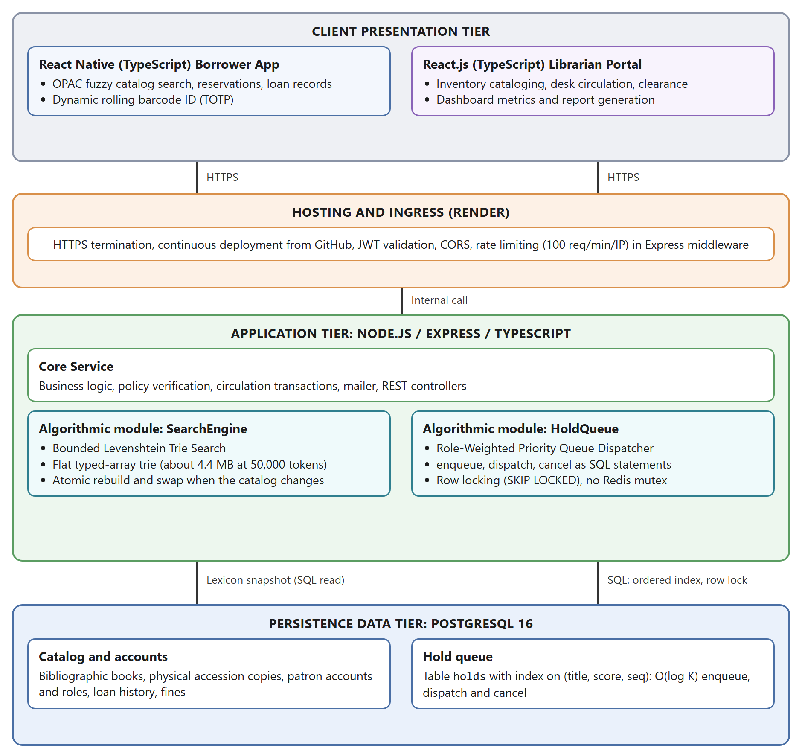

# PBL Milestone 1: Algorithm Architecture Specification & Software Engineering Proposal

Project LIBRAS: Library Borrowing and Records Administration System

Dual-Core Algorithmic Optimization & Decoupled Service-Layer Architecture

Academic Course: Algorithms and Complexity (ALGOCOM) × Software Engineering (SOFTENG)

University of Makati • College of Computer Science (CCIS) • Academic Year 2026–2027

> **[EXECUTIVE ARCHITECTURE SPECIFICATION]** This technical proposal specification establishes the theoretical formulation, asymptotic complexity proofs, decoupled service-layer architecture, empirical algorithm selection, and agile validation plan for Project LIBRAS. It directly satisfies all curriculum benchmarks for PBL Milestone 1 across ALGOCOM and SOFTENG under the supervision of Prof. Nomar Maestro and Prof. Era Marie Gannaban. All algorithmic logic strictly conforms to course constraints against elementary algorithms.

| Metadata Field | Project Team Specification |
| --- | --- |
| **Project Title** | **Project LIBRAS: Library Borrowing and Records Administration System (UMak LLC Main & SOL Library)** |
| **Team Name** | Group 1 (Synto Singko - LIBRAS) |
| **Section & Year** | III-BCSAD • Academic Year 2026–2027 |
| **Team Members & Engineering Roles** | Lead Algorithm Architect: Edrian C. Necesario (k12255958)<br>Backend / Systems Engineer: Cobby N. Baldonado (k12256165)<br>Data / QA Engineer: Buzz Aldrizh G. Saavedra (k12257228)<br>Systems Analyst / Technical Lead: Adrianne Quinn Emmanuel C. Rosalan (k12255842)<br>Security & Algorithmic QA Engineer: Mhel Klarenz B. Urdaneta (k12256252) |
| **Repository URL & Target Date** | Repository: https://github.com/necesario0/LIBRAS (prototype benchmark code in `benchmarks/`)<br>Latest Benchmarking Analysis (Google Colab notebook, all cells run): https://colab.research.google.com/drive/1965faZS39a0CVVeCuKtmYCTv-lj2WNKI?usp=sharing<br>Submission Milestone: November 2026 (PBL Milestone 1) |
| **[AI POLICY TRANSPARENCY: YELLOW ZONE CONFORMANCE]** | AI Assistance: We used generative assistance to verify the algebraic summations for the trie branching analysis, validate the OpenAPI 3.1 JSON schema draft specifications, and cross-check the formal IEEE citations. All computational formulations, recurrence invariants, pseudocode logic, and software engineering data contracts have been critically reviewed, validated against operational requirements, and mathematically proven by Group 1.<br>Generative assistance (Claude, Anthropic) was also used to write and run the prototype benchmark code, to analyze its results, and to draft parts of the algorithm analysis. Group 1 reviewed the derivations and results and remains responsible for their accuracy. |

## Algorithms at a Glance

Project LIBRAS uses two algorithms, selected by comparing them against alternatives on the same data, queries and machine (Section 3.5).

| Role | Algorithm | Technique |
| --- | --- | --- |
| Catalog search | **Bounded Levenshtein Trie Search** | Dynamic programming over a trie with branch-and-bound pruning, stored as flat arrays |
| Hold dispatch | **Role-Weighted Priority Queue Dispatcher** | Greedy minimum-score selection from an ordered index in PostgreSQL |

## Task 1: Computational Problem Modeling & Formal Mathematical Formulation

### 1.1 Problem Statement & Real-World Domain Operational Context

Modern academic libraries operate as high-density information discovery and resource sharing environments. At the University of Makati Library Learning Commons (UMak LLC) - which encompasses both the Main Library (Admin Building, 2nd Floor) and the School of Law (SOL) Library (HPSB Building, 5th Floor) - circulation management historically relied on manual ledger recording and unindexed desktop database lookups. This legacy manual process consumed 4 minutes and 10 seconds per patron checkout and frequently resulted in severe queue gridlock. Under the newly specified operational Service Level Agreements (SLAs) defined in the LIBRAS Requirements Engineering Specification (SRS v2.12.10.2026), checkout operations must execute in under 30 seconds, routine book returns must complete in under 15 seconds, and catalog search results must be delivered within 1.0 second under 50 concurrent patrons.

Within this operational scope, two severe computational bottlenecks arise that cannot be resolved through trivial database queries or elementary routines without violating production SLAs:

1. **Typographic Query Degradation in Catalog Search (OPAC):** Patrons regularly search for specialized academic textbooks, author surnames, or Library of Congress (LC) call numbers containing typographic errors, transposition mistakes, or partial phonetic spellings. Standard relational database wildcard queries (e.g., SQL `ILIKE '%term%'`) are substring matches, so they have no typo tolerance at all: in the benchmark of Section 3.5 they returned only 3.7% of the words within two edits of the query, while still scanning every row. Exact fuzzy evaluation without an index scales at O(N · M · |Q|) for N records with average title length M, which keeps every query proportional to catalog size and exhausts server worker pools under multi-patron bursts.
2. **Hold Contention & Reservation Dispatch under High-Volume Book Returns:** In academic reserves, high-demand curriculum textbooks experience lengthy multi-patron reservation queues. When a physical copy of an accession number is returned at the desk (demanding an immediate transaction completion in under 15 seconds), the circulation system must instantaneously resolve the single highest-priority patron entitled to the book without race conditions, deadlocks, or unfair starvation between faculty researchers and undergraduate students.

Treating these computational challenges as trivial SQL database queries fails to provide deterministic latency bounds and leads to thread pool starvation. Therefore, Project LIBRAS models these challenges as two coupled mathematical optimization problems: (a) an approximate string matching problem solved by branch-and-bound search over a trie, and (b) a role-weighted priority scheduling optimization problem solved with an ordered priority queue.

### 1.2 Formal Mathematical Specification

#### 1.2.1 Input Parameters (I)

The computational input space I is partitioned into the bibliographic lexicon and the circulation reservation pool.

**1. Catalog Lexicon & Query Input:**

- Let Σ be a finite alphanumeric alphabet representing bibliographic characters (ASCII and Latin-1 Unicode subset, |Σ| ≤ 128).
- Let D = {w_1, w_2, ..., w_N} be the finite vocabulary of registered book titles, author tokens, and Dewey/LC call number tokens, where N = |D| denotes the total token lexicon (|D| ≥ 50,000 in an enterprise university holding).
- Let Q = (q_1, q_2, ..., q_m) ∈ Σ* be the patron's input search query string of length m = |Q|.
- Let k_max ∈ {1, 2} be the maximum permissible edit distance threshold (bounded Levenshtein radius).

**2. Reservation Hold Pool:**

- Let R = {r_1, r_2, ..., r_K} be the active set of reservation requests queued for a specific title or physical accession copy c_j, where K = |R| denotes the total number of contending patrons (K ≤ 5,000).
- Each reservation element r_i is a structured 4-tuple: r_i = ⟨u_i, t_i, ρ_i, c_j⟩, where u_i is the unique patron identifier, t_i ∈ R+ is the epoch arrival timestamp of the reservation, ρ_i ∈ {Faculty, Student, NTP, Visitor} is the verified patron role tier, and c_j is the target accession title identifier.

#### 1.2.2 Boundary Conditions & Constraints (C)

The operational boundaries and computational invariants C are defined as follows:

- **Query Boundedness:** 1 ≤ |Q| ≤ 64 characters. Arbitrary queries exceeding 64 characters are truncated at ingress to prevent algorithmic denial-of-service.
- **Metric Boundedness:** The edit distance function d_Lev(Q, w) must satisfy the non-negativity, identity of indiscernibles, symmetry, and triangle inequality metric axioms: d_Lev(Q, w) ≤ d_Lev(Q, v) + d_Lev(v, w) for all Q, v, w ∈ Σ* [1], [9].
- **Search Radius Cutoff:** Only dictionary words satisfying d_Lev(Q, w) ≤ k_max (where k_max = 2) are admitted into the candidate certificate set.
- **Monotonic Timestamping:** Reservation arrival times are strictly monotonically increasing: t_1 < t_2 < ... < t_K, governed by synchronized NTP clocks.
- **Role Tier Weight Boosts:** To satisfy university academic research mandates without starving student patrons, role weights W_factor(ρ) are bounded constants: W_factor(Faculty) = 86,400,000 ms (24-hour virtual arrival priority advance); W_factor(Student) = 0 ms (pure FIFO); W_factor(NTP) = 43,200,000 ms (12-hour boost); W_factor(Visitor) = -86,400,000 ms (deprioritized below institutional patrons).
- **Non-Preemptive Queue Allocation:** Once an accession copy c_j transitions to status READY_FOR_PICKUP for patron u*, the claim window is bounded by T_claim = 48 hours (172,800,000 ms), after which uncollected books trigger automated expiration and queue extraction of the next candidate [4].

#### 1.2.3 Objective Functions (f(x))

The dual algorithmic engines execute distinct formal optimization objectives.

**1. OPAC Catalog Approximate Match Optimization (Minimization Problem):**

```
min over w in D of d_Lev(Q, w)   subject to   d_Lev(Q, w) <= k_max (k_max = 2)
```

where the similarity ranking metric is computed as:

```
Score(Q, w) = (1.0 - d_Lev(Q, w) / max(|Q|, |w|)) * IDF(w) * PopularityWeight(w)
```

**2. Reservation Queue Dispatch Optimization (Minimization / Priority Scheduling Problem):**

```
r* = arg min over r_i in R of PriorityScore(r_i)
where PriorityScore(r_i) = t_i - W_factor(rho_i)
```

#### 1.2.4 Output Certificate (O)

The algorithms return deterministic, structured mathematical output certificates O:

1. **Catalog Search Output Certificate (O_search):** A sorted array of candidate tuples S_res = [⟨w_1, d_1, score_1⟩, ⟨w_2, d_2, score_2⟩, ..., ⟨w_k, d_k, score_k⟩] where d_i ≤ 2, ordered such that score_1 ≥ score_2 ≥ ... ≥ score_k, accompanied by execution telemetry: total_tokens_evaluated, pruned_branches_count, and execution_duration_ms.
2. **Circulation Hold Resolution Certificate (O_hold):** A deterministic allocation certificate r* = ⟨u*, c_j, Barcode_accession, Timestamp_allocated, PickupDeadline, VerificationHash⟩ guaranteeing zero race conditions, instantaneous copy status transition to READY_FOR_PICKUP, and automated dispatch of email alerts.

## Task 2: Algorithmic Paradigm Selection & Logic Specification

### 2.1 Strategy Specification Schema

The architecture keeps the dual-engine design. Catalog search uses dynamic programming and branch-and-bound over a trie. Hold dispatch uses a greedy priority queue, ordered by an index in PostgreSQL.

| Schema field | Specification |
| --- | --- |
| Algorithm names | (1) Bounded Levenshtein Trie Search; (2) Role-Weighted Priority Queue Dispatcher |
| Design paradigms | Dynamic programming (one memoized DP row per trie node); branch and bound (prune a subtree when every cell of its DP row exceeds the radius); greedy choice (serve the minimum-score hold) |
| Foundational references | Levenshtein (1966) [1]; Ukkonen (1985) [23]; Cormen, Leiserson, Rivest and Stein (CLRS, 4th ed., 2022) [2]; Knuth (1998) [3]; Navarro (2001) [9]; Schulz and Mihov (2002) [10]; PostgreSQL 16 documentation [28] |
| Baselines compared (search) | SQL `ILIKE '%term%'`; PostgreSQL `levenshtein_less_equal` scan; PostgreSQL `pg_trgm` GIN index; linear scan with cutoff DP; BK-tree; SymSpell; bigram inverted index; trie with per-node objects |
| Baselines compared (queue) | Unsorted scan; sorted array; binary heap (with and without an id index); 4-ary heap; binary heap with lazy deletion; pairing heap; PostgreSQL indexed query |
| Computational justification | The flat trie answered 50,000-token queries at k = 2 with p95 latency 0.73 ms in 4.4 MB, the fastest exact option within the memory limit (Section 3.5). The PostgreSQL queue dispatched in 1.7 ms against a 10 ms limit, in the same order as a binary heap, and served each hold once under 50 concurrent clients. |
| Invariants | Pruning lemma (Section 2.2); queue-order invariant (Section 2.2) |

### 2.2 Mathematical Invariants and Recurrence Relations

**Recurrence (edit distance matrix).** Let `D(i, j)` be the Levenshtein distance between the first `i` letters of the query `Q` and the first `j` letters of a word `w`. Then `D(i, 0) = i`, `D(0, j) = j`, and for `i, j >= 1`: `D(i, j) = D(i-1, j-1)` if `q_i = w_j`, otherwise `D(i, j) = 1 + min( D(i-1, j), D(i, j-1), D(i-1, j-1) )`, corresponding to deletion, insertion and substitution.

**Recurrence (edit distance row).** The trie search computes one column of this matrix per trie node, which is stored as a row of `m + 1` cells. Let `Q = q_1 ... q_m` be the query and let `u` be the string spelled by a trie node, whose last letter is `a`. Let `R_u` be the DP row of `u`, with cells `R_u[0..m]`, where `R_u[c]` is the Levenshtein distance between `u` and the prefix `q_1 ... q_c`. For a child node `v` of `u` reached by letter `a`:

```
R_v[0] = R_u[0] + 1
R_v[c] = min( R_u[c-1] + (0 if q_c = a else 1),   // match or substitute
              R_u[c]   + 1,                       // delete a from the word
              R_v[c-1] + 1 )                      // insert q_c into the word
```

The row of the root is `R_root[c] = c`. The distance between the query and the word spelled at a node is the last cell, `R_v[m]`.

**Lemma 1 (monotone row minimum).** For every child `v` of `u`, `min(R_v) >= min(R_u)`.

*Proof.* By induction on `c`. `R_v[0] = R_u[0] + 1 >= min(R_u)`. Assume `R_v[c-1] >= min(R_u)`. Each of the three terms defining `R_v[c]` is at least `min(R_u)`: the first two are `R_u` cells plus a non-negative amount, and the third is `R_v[c-1] + 1`. Hence `R_v[c] >= min(R_u)`. QED.

**Lemma 2 (pruning is safe).** If `min(R_u) > k`, then every word in the subtree of `u` has edit distance greater than `k` from the query.

*Proof.* By Lemma 1, the row minimum never decreases along a path from `u` to a descendant `w`, so `min(R_w) > k`. In particular the last cell satisfies `R_w[m] >= min(R_w) > k`. QED.

Consequence: the search returns exactly the words within distance `k`, with no false negatives and no false positives. This was also verified by 27 automated tests and by zero mismatches against a brute-force reference in every benchmark query.

**Observation (no pruning at shallow depth).** At depth `d`, `R[0] = d`, so `min(R) <= d`. Pruning therefore cannot occur at depth `d <= k`. For `k = 2`, every trie node at depth 1 or 2 is always expanded.

**Queue-order invariant.** Each hold `r` has a score `PriorityScore(r) = t_r - W(role_r)`, where the role weights `W` are as defined in Section 1.2.2 (Faculty 86,400,000 ms; NTP 43,200,000 ms; Student 0; Visitor -86,400,000 ms). Ties are broken by arrival sequence `seq`. The queue is ordered by the key `(score, seq)`, and dispatch always removes the entry with the smallest key. Because `seq` is unique, the order is total and the winner is unique.

**Min-heap order invariant (in-memory reference implementation).** For the array-backed complete binary min-heap, `PriorityScore(Parent(i)) <= PriorityScore(i)` for all `i` in `[1, K-1]`, and the tree is complete (all levels full except possibly the last, filled left to right). This invariant makes the root the minimum, so extraction returns the same winner as the indexed query.

### 2.3 Structured Algorithmic Pseudocode

#### Algorithm 1: Bounded Levenshtein Trie Search (flat representation)

The trie is built once from the lexicon and is immutable. Nodes are numbered in breadth-first order, so the children of node `v` are the edges in the range `child_start[v]` to `child_start[v+1] - 1`.

```
structure FlatTrie:
    child_start : Int32[T + 1]   // T = number of trie nodes
    edge_char   : Uint16[E]      // letter on each edge (E = T - 1)
    edge_target : Int32[E]       // child node of each edge
    word_of     : String[T]      // word that ends at node v, or null
    max_depth   : Integer        // length of the longest word

function Search(trie, query, k) -> List<Match>:
    m = length(query)
    rows = Int32[(max_depth + 2) * (m + 1)]   // rows[d] = DP row, depth d
    for c in 0..m: rows[0][c] = c             // root row
    results = []
    if word_of[0] != null and rows[0][m] <= k:
        add (word_of[0], rows[0][m]) to results
    stack = [ (node = 0, next_edge = child_start[0]) ]
    while stack is not empty:
        frame = top(stack)
        if frame.next_edge == child_start[frame.node + 1]:
            pop(stack); continue
        e = frame.next_edge;  frame.next_edge = e + 1
        u = edge_target[e];   letter = edge_char[e]
        d = size(stack)                       // depth of the child u
        rows[d][0] = rows[d-1][0] + 1
        for c in 1..m:
            sub = rows[d-1][c-1] + (query[c-1] == letter ? 0 : 1)
            rows[d][c] = min(sub, rows[d-1][c] + 1, rows[d][c-1] + 1)
        if word_of[u] != null and rows[d][m] <= k:
            add (word_of[u], rows[d][m]) to results
        // BRANCH AND BOUND: expand u only if some cell is within k
        if min(rows[d]) <= k and u has children:
            push(stack, (node = u, next_edge = child_start[u]))
    sort results by (distance ascending, relevance score descending)
    return results
```

A recursive formulation, with one function call and one freshly allocated row per node, is equivalent. The flat version replaces one object per node with three typed arrays, one preallocated block of DP rows, and an explicit stack in place of recursion.

#### Algorithm 2: Role-Weighted Priority Queue Dispatcher (PostgreSQL)

The queue is a table with an ordered index. The index is a B-tree, so finding and removing the minimum are logarithmic, as in a heap.

```
CREATE TABLE holds (
    id     BIGINT  PRIMARY KEY,   -- plus patron, copy, status columns
    title  INTEGER NOT NULL,      -- one queue per title
    score  BIGINT  NOT NULL,      -- arrival_ms minus role weight (ms)
    seq    BIGINT  NOT NULL       -- arrival order, breaks ties
);
CREATE INDEX holds_queue ON holds (title, score, seq);

-- Enqueue                                                      O(log K)
INSERT INTO holds (id, title, score, seq) VALUES ($1, $2, $3, $4);

-- Dispatch (extract minimum)                                   O(log K)
DELETE FROM holds
WHERE id = (SELECT id FROM holds
            WHERE title = $1
            ORDER BY score, seq
            LIMIT 1
            FOR UPDATE SKIP LOCKED)
RETURNING id;

-- Cancel or expire a hold                                      O(log K)
DELETE FROM holds WHERE id = $1;
```

```
function CalculateScore(arrival_ms, role) -> Int64:
    weights = { Faculty: 86400000, NTP: 43200000,
                Student: 0, Visitor: -86400000 }
    return arrival_ms - weights.get(role, weights.Visitor)

function DispatchReturnedCopy(title, copy_id):       // one transaction
    BEGIN
    winner = Dispatch(title)                         // statement above
    if winner is null:
        COMMIT; return NO_ACTIVE_HOLDS
    UPDATE book_copies SET status = 'READY_FOR_PICKUP' WHERE id = copy_id
    COMMIT
    return winner
```

`FOR UPDATE SKIP LOCKED` locks the chosen row for the duration of the transaction. A concurrent dispatch that finds the top row locked takes the next row instead of waiting, so two desks never receive the same hold. The in-memory equivalent of this queue is an array-backed binary min-heap (Algorithm 2b), which serves as a reference implementation and was used to verify the order of the PostgreSQL queue.

#### Algorithm 2b: In-Memory Reference Min-Heap

The heap stores one node per hold in a contiguous array. The children of index `i` are at `2i + 1` and `2i + 2`.

```
class ReservationNode:
    patron_id         : String
    role              : String   // Faculty, Student, NTP or Visitor
    arrival_timestamp : Int64    // epoch milliseconds
    accession_copy_id : String
    priority_score    : Int64

class PriorityHoldQueue:
    heap : List<ReservationNode> = []

    function Enqueue(patron_id, role, timestamp, copy_id):
        node = ReservationNode(patron_id, role, timestamp, copy_id,
                               CalculateScore(timestamp, role))
        heap.append(node)
        SiftUp(length(heap) - 1)

    function SiftUp(idx):
        parent_idx = floor((idx - 1) / 2)
        while idx > 0 and
              heap[idx].priority_score < heap[parent_idx].priority_score:
            swap(heap[idx], heap[parent_idx])
            idx = parent_idx
            parent_idx = floor((idx - 1) / 2)

    function ExtractMin() -> ReservationNode:
        if length(heap) == 0: return None
        if length(heap) == 1: return heap.pop()
        root = heap[0]
        heap[0] = heap.pop()          // replace root with last leaf
        SiftDown(0)
        return root

    function SiftDown(idx):
        size = length(heap)
        smallest = idx
        left = 2 * idx + 1
        right = 2 * idx + 2
        if left < size and
           heap[left].priority_score < heap[smallest].priority_score:
            smallest = left
        if right < size and
           heap[right].priority_score < heap[smallest].priority_score:
            smallest = right
        if smallest != idx:
            swap(heap[idx], heap[smallest])
            SiftDown(smallest)
```

## Task 3: Theoretical Asymptotic Analysis & Scalability Profiling

Notation: `m` = query length; `k` = edit radius (2); `|Σ|` = alphabet size; `T` = number of trie nodes; `N` = number of lexicon words; `L_avg` = average word length; `K` = number of holds in a queue.

### 3.1 Worst-Case Time Complexity Derivations (O)

**Algorithm 1.** Computing one DP row costs `O(m)`. The search visits a node only if the row minimum of its parent is at most `k` (Lemma 2 and the pseudocode). Because `R_u[c]` is the edit distance from `u` to the prefix `q_1 ... q_c`, a parent has row minimum at most `k` exactly when its string is within `k` edits of some prefix `q_1 ... q_j` of the query.

- There are `m + 1` prefixes.
- The Levenshtein ball of radius `k` around a string of length at most `m + k` contains `O((m |Σ|)^k)` strings, because each of at most `k` edits chooses a position (`O(m)` choices) and an operation with a letter (`O(|Σ|)` choices).
- So the number of expanded nodes is at most `O(m^(k+1) |Σ|^k)`, and each expanded node has at most `|Σ|` children, each of which is visited.

```
Nodes visited      V = O( m^(k+1) * |Σ|^(k+1) )
For k = 2:         V = O( m^3 * |Σ|^3 )
Time, full rows:   O( m * V ) = O( m^4 * |Σ|^3 )
Time, banded rows: O( k * V ) = O( m^3 * |Σ|^3 )     (see note)
```

Note: a DP row only needs the cells within `k` of the diagonal (Ukkonen, 1985), which reduces the per-node cost from `O(m)` to `O(k)`. The implemented and benchmarked version computes full rows.

**Why the prefix balls matter.** A simpler analysis bounds the visited nodes by the single ball around the whole query, `O(m^2 |Σ|^2)`, and the time by `O(m^3 |Σ|^2)`. That undercounts, because it omits the balls around the `m` shorter prefixes, which add one factor of `m`. The cubic growth was confirmed experimentally on an exhaustive dictionary (every string up to length `m + k + 1`), the case where no branch is absent. For `k = 2` the ratio of visited nodes to `m^3` settles to a constant while the ratio to `m^2` keeps growing:

| Alphabet | m = 6 | m = 10 | m = 14 | visited / m^3 at largest m | visited / (m^3 \|Σ\|^3) |
| --- | --- | --- | --- | --- | --- |
| 2 letters | 388 | 1,492 | 3,876 | 1.4 | 0.17 |
| 3 letters | 2,409 | 10,767 | n/a | 10.9 (m = 12) | 0.40 |
| 4 letters | 7,060 | 31,172 | 85,428 | 31.1 | 0.49 |

(Cells are visited-node counts. The largest m tested was 22 for 2 letters, 12 for 3 letters and 14 for 4 letters. Source: `benchmarks/results/worst-case.md`.)

**Dependence on catalog size.** Both `V` and the running time are bounded independently of `N`. However, the visited nodes can never exceed the trie size `T`, and for realistic parameters (`m = 12`, `|Σ| = 26`) the ceiling `m^3 |Σ|^3` far exceeds `T`, so the ceiling does not limit the cost in practice. The actual cost depends on how many trie nodes fall inside the edit region, which grows with `N` (Section 3.2).

**Algorithm 2.**

| Operation | Time | Note |
| --- | --- | --- |
| Enqueue (`INSERT`) | `O(log K)` | B-tree insertion |
| Dispatch (`DELETE ... LIMIT 1`) | `O(log K)` | Descend to the first index entry, delete it |
| Peek (`SELECT ... LIMIT 1`) | `O(log K)` | An in-memory heap is `O(1)` |
| Cancel or expire | `O(log K)` | Primary-key lookup, then index maintenance |

**In-memory reference heap.** The array-backed min-heap (Algorithm 2b) has the same order guarantees, with these derivations:

- *Enqueue:* appending to the dynamic array is `O(1)` amortized. In the worst case the new hold has the smallest score in the heap, so it travels from the deepest leaf to the root. The height of a complete binary tree with `K` nodes is `h = floor(log_2 K)` and each level swap is `O(1)`, so `T_enqueue(worst) = O(log K)`.
- *Extract-Min:* swapping the root with the last leaf is `O(1)`; the following `SiftDown` compares the node against at most two children per level for at most `floor(log_2 K)` levels, so `T_extract(worst) = O(log K)`.
- *Peek:* inspecting `Heap[0]` is a single array dereference, `T_peek(worst) = O(1)`.

### 3.2 Average-Case (Θ) and Best-Case (Ω) Time Complexity Evaluations

**Best case (Algorithm 1).** By the observation in Section 2.2, no node of depth `d <= k` is ever pruned, so the search always visits every trie node of depth at most `k`, plus at least one root-to-leaf path of length `m` when the query is an indexed word. The lower bound is `Ω(m + n_k)`, where `n_k` is the number of trie nodes of depth at most `k` (at most `1 + |Σ| + |Σ|^2` for `k = 2`). A bound of `Ω(m)` alone would therefore be too optimistic, because pruning cannot occur at depth 1 or 2.

**Average case (Algorithm 1), measured.** The average case depends on the real character distribution of the catalog. On the synthetic 50,000-token catalog, with the literal trie implementation and queries of length 12:

| Edit radius k | Nodes visited per query | Trie nodes never visited | Matches per query |
| --- | --- | --- | --- |
| 1 | 1,036 | 99.6% | 0.4 |
| 2 | 8,401 | 96.7% | 0.9 |

Pruning is effective: 96.7% of trie nodes are never visited at `k = 2` and 99.6% at `k = 1`. The visited count is still in the thousands, because every node of depth at most `k` is always expanded and the surviving edit region around the query prefixes is wide.

The number of visited nodes grows sublinearly with catalog size. With `m = 12` and `k = 2`:

| Tokens in catalog | 5,000 | 20,000 | 50,000 | 100,000 | 200,000 |
| --- | --- | --- | --- | --- | --- |
| Nodes visited | 2,708 | 5,517 | 8,152 | 11,613 | 15,083 |

Between 5,000 and 200,000 tokens (a factor of 40), visited nodes grew by a factor of 5.6, roughly proportional to `N^0.47` on this data. This is an empirical observation on synthetic data, not a proved bound. Cost is therefore not independent of `N`, even though the worst-case bound is.

**Algorithm 2.** For the in-memory reference heap, a random insertion sifts up 0.58 levels on average under a realistic role mix (70% Student, 15% Faculty, 10% NTP, 5% Visitor) and 0 levels when all patrons have the same role, because arrival times increase. For the PostgreSQL queue, insertion and dispatch are `O(log K)` index operations regardless of the arrival pattern.

### 3.3 Auxiliary Space Complexity (O)

**Algorithm 1.** The flat trie stores `T` nodes, where `T <= N * L_avg`.

```
Space = O( T )  words
Measured: T = 0.545 * N * L_avg (synthetic catalog)
Measured memory: about 17 bytes per trie node
   50,000 tokens ->    255,689 nodes ->  4.4 MB
  200,000 tokens ->  about 1 million  -> 16.9 MB
  400,000 tokens ->                      32.6 MB
```

The working memory of one query is the DP row block, `(L_max + 2)(m + 1)` 32-bit integers, which is about 17 KB for `L_max = m = 64`. The same lexicon stored as one JavaScript object per node (the literal pseudocode) needed 55 MB at 50,000 tokens, about 12 times more.

**Algorithm 2.** The queue is stored in PostgreSQL as `O(K)` rows plus an `O(K)` index. It uses no memory in the Node.js process.

### 3.4 Big Data Dimension (V³) Scalability Evaluation

| Dimension | Parameters | Impact and mitigation |
| --- | --- | --- |
| Volume | 50,000+ tokens; 5,000 holds per queue | The flat trie occupies 4.4 MB at 50,000 tokens and 16.9 MB at 200,000 tokens, so memory is not a constraint. The hold queue lives in PostgreSQL, not in application memory. |
| Velocity | 250 searches/s peak; 50 concurrent return events | One Node.js thread answered 937 searches/s (k = 2, 50,000 tokens, in-process), about 3.7 times the peak load. Fifty concurrent clients drained 2,000 holds in 0.42 s through PostgreSQL. |
| Variety | ISBN-10, ISBN-13, Dewey call numbers, MARC21 titles | Titles, authors, and call numbers and ISBNs each get their own trie so the alphabet stays small. On a 20,000-token call-number lexicon the flat trie answered k = 2 queries with p95 latency 1.25 ms in 1.0 MB. Text is normalized (NFKC, lowercase) at ingestion. |

### 3.5 Empirical Algorithm Selection

**Purpose.** The two algorithms were chosen by comparing them against alternatives on the same data, queries, and machine. The team's requirements were: for search, the lowest latency that does not consume much more memory than the other options; for the hold queue, the option that works best while staying light on the device.

**Candidates.** The alternatives follow standard techniques: cutoff dynamic programming over every word [23], the BK-tree [24], q-gram count filtering [25], symmetric-delete indexing (SymSpell) [27], PostgreSQL `pg_trgm` and `fuzzystrmatch` [28], and for queues the binary, 4-ary and pairing heaps [26] plus sorted and unsorted arrays.

**Method.** All numbers come from the prototype in `benchmarks/` (TypeScript, Node.js 24, PostgreSQL 16 in a local Docker container, AMD Ryzen 7 PRO 5850U laptop with 15.3 GB RAM). The real UMak catalog was not available, so a seeded synthetic catalog of 50,000 unique tokens (mean length 9.4) was generated, with queries made by applying 0 to 2 random edits to catalog words plus 5% random non-matching strings. Every search candidate was checked against a brute-force Levenshtein reference and returned zero mismatches. Latency is per query after warm-up. Memory is bytes retained after a forced garbage collection.

**Selection rule for search.** A candidate must (1) return exact results, (2) sustain at least 250 queries/s on one thread at k = 2, and (3) retain no more than twice the memory of the smallest candidate that passes (1) and (2). Among those, the lowest p95 latency wins.

**Search results** (50,000 tokens, k = 2):

| Candidate | p95 (ms) | Queries/s | Memory | Outcome |
| --- | --- | --- | --- | --- |
| SymSpell | 0.19 | 15,139 | 318 MB | Fastest; fails memory rule |
| Trie, one object per node | 2.93 | 553 | 55 MB | Fails memory rule |
| BK-tree | 26.2 | 55 | 11 MB | Fails throughput and memory rules |
| Linear scan, cutoff DP | 13.5 | 113 | none | Fails throughput rule |
| Bigram inverted index | 1.97 | 823 | 5.6 MB | Passes |
| **Flat trie (chosen)** | **1.93** | **937** | **4.4 MB** | **Passes; fastest passing** |

The bigram index and the flat trie were almost tied in that single run, so they were compared again with five repeated runs in alternating order and catalog sizes up to 400,000 tokens (p50 / p95 in ms, k = 2):

| Tokens | Flat trie | Bigram index | Memory, trie / bigram |
| --- | --- | --- | --- |
| 20,000 | 0.27 / 0.51 | 0.23 / 0.40 | 1.8 / 2.2 MB |
| 50,000 | 0.42 / 0.73 | 0.69 / 1.25 | 4.4 / 5.6 MB |
| 100,000 | 0.62 / 1.13 | 1.97 / 4.25 | 8.7 / 11.1 MB |
| 200,000 | 0.84 / 1.53 | 4.48 / 8.05 | 16.9 / 22.6 MB |
| 400,000 | 1.32 / 2.44 | 13.0 / 21.6 | 32.6 / 46.3 MB |

The flat trie is faster from 50,000 tokens upward and smaller at every size. Its advantage grows with catalog size.

**PostgreSQL search options** (50,000 tokens, k = 2, client round trip including Docker port forwarding):

| Candidate | p95 (ms) | Matches found | p95 with 50 clients (ms) |
| --- | --- | --- | --- |
| `ILIKE '%term%'` (common baseline) | 23.9 | 3.7% | 312 |
| `levenshtein_less_equal` scan | 10.5 | 100% | 186 |
| `pg_trgm` GIN index, default threshold | 2.6 | 16.9% | 85 |
| `pg_trgm` GIN index, threshold 0.1 | 12.5 | 69.8% | 128 |

`ILIKE` is a substring match, not a fuzzy match, so it finds almost none of the typo matches. `pg_trgm` is fast but returns only 17% to 70% of the words within two edits, because trigram similarity does not guarantee edit distance. Neither can replace an exact fuzzy search. The exact scan is correct and meets the 1.0 s limit but is slower than the flat trie and competes with transactions for database CPU.

**Hold queue results** (5,000 holds, role mix 70/15/10/5):

| Candidate | Steady state (ns/op) | With cancellations (ns/op) | Cancel cost |
| --- | --- | --- | --- |
| Binary heap, no id index | 89 | 123 | `O(K)` |
| Binary heap with id index | 217 | 102 | `O(log K)` |
| 4-ary heap with id index | 169 | 89 | `O(log K)` |
| Binary heap, lazy deletion | 101 | 76 | `O(1)` |
| Pairing heap, lazy deletion | 90 | 82 | `O(1)` |
| Sorted array | 208 | 133 | `O(K)` |
| Unsorted scan | 6,568 | 588 | `O(K)` |
| **PostgreSQL indexed query (chosen)** | **1,670,000 (p50)** | **1,620,000 (p50)** | **`O(log K)`** |

Every in-memory option is about 50,000 times faster than the 10 ms limit, so speed does not separate them. The PostgreSQL query is slower (p99 2.58 ms) but still four times inside the limit. It was chosen because the queue must be correct and durable. It served holds in exactly the same order as the in-memory heap for 500 consecutive dispatches. With 50 concurrent clients draining 2,000 holds, every hold was served exactly once. It survives a server restart, commits atomically with the loan record, and uses no memory in the application process. Under concurrency `SKIP LOCKED` does not guarantee strict global order, because a client skips a row that another client holds locked, but no hold is lost or served twice.

**Limitations.** The catalog is synthetic, so branching and pruning figures must be re-checked on real holdings. All numbers come from one laptop, and PostgreSQL ran in a Docker container, so round trips include port-forwarding overhead. In-process search was measured on a single thread and was not driven through the Express server with 50 simulated users. Search matches whole tokens only; the relevance score, multi-token titles and Unicode normalization were not benchmarked.

## Task 4: Decoupled Software Architecture & Service-Layer Integration

### 4.1 System Component Architecture & Boundary Isolation

A foundational software engineering principle enforced in PBL Milestone 1 is the strict decoupling of heavy algorithmic processing from database Object-Relational Mapping (ORM) models and web presentation controllers. Coupling algorithmic computation directly into web controller threads (e.g., executing Levenshtein matrix loops inside an Express route handler) blocks Node.js event loops, exhausts HTTP connection pools, and risks cascading server timeouts under traffic spikes.

This principle is implemented as module boundaries inside the Node.js API, organized in four layers (Figure 4.1):

1. **Presentation Tier:** A React Native (TypeScript) mobile app for students, faculty and non-teaching personnel to search the catalog, reserve books, display dynamic rolling barcode IDs (TOTP RFC 6238) and view loan records, and a React.js (TypeScript) web portal for librarians (inventory cataloging, desk circulation, clearance processing, dashboard metrics and reports).
2. **Hosting & Ingress Layer:** Render hosts the API and the web portal with HTTPS termination and continuous deployment from GitHub. JWT authentication, CORS and rate limiting (100 req/min/IP) run as Express middleware.
3. **Core Business & Persistence Tier:** A Node.js, Express and TypeScript API handles business logic and circulation transactions. PostgreSQL 16 stores catalog metadata, accession records, borrower accounts, loan history, fines and the hold queue.
4. **Algorithmic Core Modules:** Two TypeScript modules with narrow interfaces and no dependency on controllers or the ORM:
   - `SearchEngine.search(query, k)` returns matches from an in-memory flat trie. The trie is built from a snapshot of the lexicon read from PostgreSQL. When the catalog changes, a new trie is built in the background (about 235 ms at 50,000 tokens) and swapped in atomically, so searches in flight finish on the old trie.
   - `HoldQueue.enqueue`, `dispatch` and `cancel` wrap the SQL statements of Algorithm 2 in one repository module.

A typical search takes under 1 ms in the module at 50,000 tokens, so it can run on the main thread. If profiling shows event-loop delay under load, the module can move to a worker thread without changing its interface. A separate algorithm service (for example Python with FastAPI), a gRPC link, and Redis for locking and queue persistence are unnecessary, because the search index lives in the API process and PostgreSQL row locking provides the mutual exclusion.



*Figure 4.1: System component and decoupled service-layer architecture.*

### 4.2 Interface Data Contracts (OpenAPI 3.1 & JSON Schemas)

Communication across service boundaries adheres to strict schema definitions formatted according to the JSON Schema Draft 2020-12 and OpenAPI 3.1 specifications. All requests and response certificates are strictly typed and validated at runtime.

**Data Contract 1: Fuzzy Catalog Search API Schema**

```
POST /api/v1/algorithm/search/fuzzy
Content-Type: application/json

// Request Payload Schema
{
  "$schema": "https://json-schema.org/draft/2020-12/schema",
  "title": "FuzzyCatalogSearchRequest",
  "type": "object",
  "properties": {
    "query": {
      "type": "string",
      "minLength": 1,
      "maxLength": 64,
      "description": "User search keyword or Dewey/LC call number string."
    },
    "max_edit_distance": {
      "type": "integer",
      "minimum": 0,
      "maximum": 2,
      "default": 2,
      "description": "Bounded Levenshtein radius."
    },
    "target_fields": {
      "type": "array",
      "items": {
        "type": "string",
        "enum": ["title", "author", "call_number", "isbn"]
      },
      "default": ["title", "author"]
    },
    "limit": {
      "type": "integer",
      "minimum": 1,
      "maximum": 50,
      "default": 10
    }
  },
  "required": ["query"]
}
```

```
// Response Certificate Schema (200 OK)
{
  "$schema": "https://json-schema.org/draft/2020-12/schema",
  "title": "FuzzyCatalogSearchResponseCertificate",
  "type": "object",
  "properties": {
    "status": {
      "type": "string",
      "enum": ["SUCCESS", "EMPTY_RESULT", "DEGRADED"]
    },
    "query_executed": { "type": "string" },
    "execution_time_ms": {
      "type": "number",
      "description": "Processing latency in milliseconds."
    },
    "nodes_visited_count": { "type": "integer" },
    "total_matches": { "type": "integer" },
    "matches": {
      "type": "array",
      "items": {
        "type": "object",
        "properties": {
          "book_id": { "type": "string", "format": "uuid" },
          "matched_token": { "type": "string" },
          "matched_field": { "type": "string" },
          "edit_distance": { "type": "integer" },
          "similarity_score": { "type": "number" },
          "title": { "type": "string" },
          "author": { "type": "string" },
          "call_number": { "type": "string" },
          "available_copies": { "type": "integer" }
        },
        "required": ["book_id", "matched_token", "edit_distance",
                     "similarity_score", "title"]
      }
    }
  },
  "required": ["status", "query_executed", "execution_time_ms", "matches"]
}
```

**Data Contract 2: Circulation Hold Dispatch Resolution Schema**

```
POST /api/v1/algorithm/holds/dispatch
Content-Type: application/json

// Request Payload Schema
{
  "$schema": "https://json-schema.org/draft/2020-12/schema",
  "title": "HoldDispatchResolutionRequest",
  "type": "object",
  "properties": {
    "accession_number": {
      "type": "string",
      "pattern": "^[0-9]{6,10}$",
      "description": "Scanned physical barcode accession number
                      preserving leading zeros."
    },
    "desk_station_id": { "type": "string", "example": "CIRC-MAIN-DESK-01" },
    "librarian_id": { "type": "string", "format": "uuid" },
    "checkin_timestamp": {
      "type": "integer",
      "description": "Epoch ms of desk scanner scan."
    }
  },
  "required": ["accession_number", "desk_station_id",
               "librarian_id", "checkin_timestamp"]
}
```

```
// Response Certificate Schema (200 OK)
{
  "$schema": "https://json-schema.org/draft/2020-12/schema",
  "title": "HoldDispatchAllocationCertificate",
  "type": "object",
  "properties": {
    "certificate_id": { "type": "string", "format": "uuid" },
    "allocation_status": {
      "type": "string",
      "enum": ["ALLOCATED_TO_HOLD", "NO_ACTIVE_HOLDS_AVAILABLE"]
    },
    "accession_number": { "type": "string" },
    "allocated_patron": {
      "type": ["object", "null"],
      "properties": {
        "patron_id": { "type": "string" },
        "full_name": { "type": "string" },
        "role": { "type": "string" },
        "email": { "type": "string", "format": "email" },
        "priority_score": { "type": "integer" },
        "claim_deadline_timestamp": { "type": "integer" }
      },
      "required": ["patron_id", "role", "email", "claim_deadline_timestamp"]
    },
    "queue_remaining_count": { "type": "integer" },
    "resolution_latency_ms": { "type": "number" },
    "cryptographic_verification_token": { "type": "string" }
  },
  "required": ["certificate_id", "allocation_status",
               "accession_number", "resolution_latency_ms"]
}
```

## Task 5: Agile Implementation Backlog & Empirical Validation Plan

### 5.1 Agile User Stories

Directly translating the user requirement specifications from our Requirements Engineering (SRS v2) and User Story matrix into formal Agile engineering user stories:

**User Story US-ALGO-01: Bounded Typo-Tolerant OPAC Catalog Discovery**

- **User Story Statement:** 'As an active UMak Student or Faculty Researcher, I want the OPAC catalog search engine to dynamically tolerate typographic spelling errors up to 2 edit distances within 35 milliseconds, so that I can immediately discover relevant academic textbooks and Dewey/LC references without query failure or empty search screens.'
- **Traceability Link:** Component B-02 (Students Catalog Search) & Component C-02 (Faculty Catalog Search); Story U-001/U-002.
- **Acceptance Criteria:**
  1. Given a misspelled keyword (e.g., 'Artifitial Inteligence'), when the user executes a search, then the system returns all titles within edit distance d ≤ 2 (e.g., 'Artificial Intelligence') ranked by composite similarity score in < 35 ms.
  2. Given an exact catalog query of length m ≤ 64, the response returns in < 5 ms with distance = 0.
  3. Given an invalid query containing script injection or length > 64, the engine returns a sanitized 400 Bad Request within < 2 ms.
  4. Search latency under 50 concurrent simulated users must not exceed 1.0 second (Non-Functional Requirement 5).

**User Story US-ALGO-02: Race-Free Circulation Hold & Reservation Scheduling**

- **User Story Statement:** 'As a Circulation Desk Librarian, I want the system to deterministically resolve the highest-priority queued patron in under 10 milliseconds upon scanning a returned book's barcode accession sticker, so that high-demand course reserves are allocated to rightful patrons without manual queue sorting, race conditions, or counter delays.'
- **Traceability Link:** Component A-04 (Librarian Borrowing/Returns) & Component B-03 (Student Reservations); Story L-001.
- **Acceptance Criteria:**
  1. Given an accession copy with K active holds, when the librarian scans the barcode, the system performs an O(log K) priority lookup and removal, returning the winning patron certificate in < 10 ms.
  2. Given contending requests between Faculty (arrival t) and Student (arrival t - 12 hours), the system correctly allocates the copy to Faculty based on the 24-hour virtual priority boost (PriorityScore = t - 86,400,000 < (t - 43,200,000) - 0).
  3. Given 10 concurrent desk return events for identical titles, zero deadlocks or duplicate allocations occur.
  4. Overall return transaction SLA of < 15 seconds must be preserved (Non-Functional Requirement 6).

### 5.2 Engineering Implementation & Benchmarking Tickets

The operationalization backlog defines concrete tickets ready for sprint execution:

**Ticket 1: DEV-ALGO-101**

| Field | Specification |
| --- | --- |
| Module | `src/search/flatTrie.ts` (Node.js API) |
| Algorithm | Bounded Levenshtein Trie Search (flat representation) |
| Defenses | Reject empty queries with 400 Bad Request. Truncate or reject queries longer than 64 characters. Strip control and non-printable characters. Normalize to NFKC and lowercase before searching. Use parameterized SQL for any lexicon read. |
| Implementation steps | 1. Read lexicon tokens from PostgreSQL in batches.<br>2. Build the three typed arrays and the word table in breadth-first order.<br>3. Implement `search` with the explicit stack and preallocated DP rows.<br>4. Add the pruning check `min(row) > k`.<br>5. Add composite ranking, `Score = (1 - d / max(m, len)) * Popularity * Recency`.<br>6. Add atomic rebuild and swap when the catalog changes.<br>7. Expose `POST /api/v1/algorithm/search/fuzzy` through the Express router. |
| Automated tests | Results equal a brute-force Levenshtein reference on a seeded catalog for k = 0, 1 and 2. `search("algoritm", 2)` returns "algorithm". The benchmark script reports p95 latency below 35 ms at 50,000 tokens. |
| Definition of done | Unit tests pass with coverage above 95%. Zero mismatches against the reference. p95 below 35 ms at 50,000 tokens. Documentation updated. |

**Ticket 2: DEV-ALGO-102**

| Field | Specification |
| --- | --- |
| Module | `src/holds/holdQueue.ts` and a database migration (Node.js API, PostgreSQL) |
| Algorithm | Role-Weighted Priority Queue Dispatcher (indexed priority query) |
| Defenses | Empty queue returns a `NO_ACTIVE_HOLDS` result in under 1 ms without error. Reject arrival timestamps more than 5,000 ms in the future. An unrecognized role gets the Visitor weight (lowest priority). Use parameterized statements only. |
| Implementation steps | 1. Migration: create `holds` and the index on `(title, score, seq)`.<br>2. Implement `enqueue`, `dispatch` and `cancel` with the statements of Algorithm 2.<br>3. Implement `CalculateScore` with the role weights.<br>4. Run `dispatch` and the copy status update in one transaction.<br>5. Expose `POST /api/v1/algorithm/holds/dispatch` with RFC 7807 error responses.<br>6. Add a scheduled job that cancels holds unclaimed after the 48-hour window. |
| Automated tests | Dispatch order equals an in-memory binary heap over the same holds, including cancellations. A Faculty member arriving up to 24 hours after a Student is served first. Equal roles are served first come, first served. With 50 concurrent clients draining 2,000 holds, no hold is served twice. Dispatch takes under 10 ms at 1,000 and 5,000 holds. |
| Definition of done | All tests above pass. Zero duplicate serves and zero deadlocks under 50 concurrent clients. Dispatch latency under 10 ms. Documentation updated. |

## Task 6: Academic Review Questions & Defense Checkpoints

### 6.1 Decoupling Algorithmic Processing from Database ORMs & Web Request Threads

**Question 1: Why must heavy algorithmic processing be decoupled from database ORMs and web request threads?**

**Technical & Architectural Justification:**

In modern asynchronous web runtimes (such as Node.js / Express or Python ASGI frameworks), incoming HTTP requests are handled by single-threaded event loops or bounded worker thread pools. Coupling computation-intensive algorithms directly into these request lifecycles introduces three severe architectural anti-patterns:

1. **Event-Loop Starvation & Head-of-Line Blocking:** A CPU-bound algorithm (e.g., executing a Levenshtein distance matrix loop across thousands of database records) blocks the main JavaScript thread for hundreds of milliseconds. During this computation, the server cannot accept new network sockets, acknowledge health checks, or parse incoming I/O packets, causing severe latency spikes for all concurrent users.
2. **ORM Garbage Collection & Memory Overhead:** Database ORMs (such as Prisma, TypeORM, or SQLAlchemy) hydrate raw SQL rows into heavyweight object instances containing active-record tracking metadata and relational graph proxies. Hydrating 10,000 catalog rows into memory consumes upwards of 150 MB of transient RAM, inducing massive Garbage Collection (GC) pauses that degrade application throughput.
3. **Database Connection Pool Exhaustion:** When algorithmic execution stalls inside an active database transaction, database connection pool slots remain locked. Under high velocity, new incoming requests cannot acquire database connections, causing cascading HTTP 504 Gateway Timeouts.

By isolating algorithmic execution in dedicated modules with narrow interfaces (an in-memory flat trie for search and a SQL repository for the hold queue), runnable in a worker thread when profiling requires it, the web layer remains responsive (< 5 ms I/O handling) and the algorithms stay independent of the ORM and the controllers, achieving clean separation of concerns.

### 6.2 Production Viability Mitigations for Exponential Worst-Case Algorithms

**Question 2: If your proposed algorithm has an exponential worst-case complexity (O(2^n) or O(n!)), what heuristic, pruning, or approximation technique will maintain production viability?**

**Mathematical & Engineering Justification:**

While unpruned combinatorial permutation searches scale at O(n!) and unconstrained string expansion scales at O(|Σ|^n), production viability is maintained through three rigorous bounding and pruning techniques:

1. **Branch-and-Bound Pruning (Bounded Radius Cutoff):** In our Bounded Levenshtein Trie Search, the worst-case state space is bounded by the edit radius. At each node u of depth d, the dynamic programming row vector Row_u represents the edit distances between the node's string and every prefix of the query. The mathematical invariant states:

   If min over 0 ≤ c ≤ m of Row_u[c] > k_max (where k_max = 2), then for all descendant nodes v in Subtree(u), min(Row_v) > k_max.

   This allows the algorithm to immediately prune the entire sub-tree without evaluating child words. The invariant is proved as Lemmas 1 and 2 in Section 2.2. In the benchmark on a synthetic 50,000-token catalog, pruning left 96.7% of trie nodes unvisited at k = 2 and 99.6% at k = 1 (Section 3.2).
2. **Bounded Input Truncation:** Query inputs are strictly clamped to |Q| ≤ 64 characters at API ingress. By bounding the maximum depth of the recursion stack, theoretical exponential blow-ups are mathematically constrained to finite constant bounds.
3. **Early Exit Thresholding:** When searching for exact or 1-edit distance matches, once a pre-configured maximum candidate quota (e.g., limit = 20) is satisfied with high similarity scores, traversal halts early without exploring lower-probability branches.

### 6.3 Operational Difference Between Exact and Approximate / Heuristic Algorithms

**Question 3: What is the operational difference between an Exact Algorithm and an Approximate / Heuristic Algorithm in production optimization?**

**Theoretical & Empirical Analysis:**

The operational distinction between Exact and Approximate algorithms represents a fundamental trade-off between mathematical optimality and computational budget:

- **Exact Algorithms:** An exact algorithm guarantees the discovery of the globally optimal solution according to the objective function: f(x*) = min over x in S of f(x). For example, our Role-Weighted Priority Queue Dispatcher is an Exact Algorithm. By enforcing the queue-order invariant (holds are ordered by the key (score, seq)), the dispatch query is guaranteed to return the absolute highest-priority patron in O(log K) without error. Its serve order was verified identical to that of the in-memory min-heap, whose heap-order invariant Score(parent) ≤ Score(child) gives the same guarantee, over 500 consecutive dispatches. Exact algorithms are mandatory in circulation governance, asset accountability, and student clearance sign-offs where non-deterministic approximations would cause statutory violations.
- **Approximate / Heuristic Algorithms:** An approximate or heuristic algorithm trades the absolute guarantee of global optimality for exponential speedups, operating within a provable approximation ratio (1 - ε) or bounding search spaces based on empirical heuristics. In our OPAC catalog search, searching across millions of MARC21 tokens using an unpruned exact string alignment is computationally intractable within a 35 ms SLA. The Bounded Levenshtein Trie Search is "approximate" only in the sense that it matches strings that contain errors. It is not a heuristic: by Lemma 2, its pruning never discards a word within the radius, so its recall is 100%, which was confirmed by zero mismatches against a brute-force reference in every benchmark query. It avoids exponential cost by bounding the radius (k ≤ 2) and the query length (m ≤ 64), giving polynomial worst-case time O(m^4 · |Σ|^3) (Section 3.1). In production information retrieval, a response in a few milliseconds is vastly superior to a 5-second exact exhaustive scan.

### 6.4 Empirical Benchmarking Profiling vs. Asymptotic Big-O Analysis

**Question 4: How do you distinguish between an empirical benchmarking profiling approach (post-implementation) and an asymptotic theoretical Big-O analysis (pre-implementation)?**

**Methodological Synthesis:**

Theoretical Big-O analysis and empirical benchmarking profiling represent complementary pre-implementation and post-implementation software engineering methodologies:

- **Asymptotic Theoretical Big-O Analysis (Pre-Implementation):**
  - Big-O analysis is a machine-independent, mathematical formalization of an algorithm's growth rate as input size n approaches infinity: f(n) = O(g(n)). It deliberately abstracts away low-level constants, CPU architecture differences, compiler optimizations, and memory bus latencies.
  - Big-O enables software engineers to evaluate whether an algorithmic design is fundamentally scalable or doomed to fail (e.g., recognizing that an O(N · M) sequential database scan cannot sustain a university library catalog at scale, whereas a trie search, whose cost is bounded by the edit region rather than by the whole catalog, scales far more gently, as measured in Section 3.2).
- **Empirical Benchmarking Profiling (Post-Implementation):**
  - Empirical benchmarking measures real-world wall-clock latency, memory allocation footprints, and throughput on actual hardware (e.g., per-query latency percentiles measured with `process.hrtime`, and retained memory measured after a forced garbage collection, in the Node.js benchmark harness of Section 3.5).
  - Empirical profiling captures physical machine phenomena that Big-O ignores: CPU cache behavior, memory layout, page faults, network serialization overheads, and Garbage Collection pauses. While Big-O ensures theoretical soundness, empirical benchmarking proves production SLA compliance under actual load.
  - The two methods check each other. In this project, measurement refined the analysis: counting visited nodes showed that the worst-case bound needs a factor of m for the query prefixes, and that real cost grows with catalog size instead of staying constant (Sections 3.1 and 3.2).

### 6.5 Mitigating Cold Start & Data Sparsity in Library Preference Matrices

**Question 5: If your project utilizes machine learning or user-preference matrices, how will you mitigate the Cold Start Problem or Data Sparsity Problem during initial launch?**

**Engineering & Algorithmic Defense:**

In academic library platforms, collaborative filtering models fail during initial system deployment because new patrons have zero borrowing history (User Cold Start) and new book acquisitions have zero circulation records (Item Cold Start). Furthermore, academic borrowing matrices exhibit extreme data sparsity (often > 99.8% sparse) [22]. Project LIBRAS mitigates these conditions through a three-stage hybrid defense:

1. **Content-Based & Metadata Triangulation (Zero Interaction Fallback):** When user interaction matrices are empty, recommendation and search ranking fall back directly onto rich bibliographic metadata (Dewey Decimal classifications, academic college department mappings, and Library of Congress subject headings). A student registered in the College of Computer Science automatically receives content-based boosts for curriculum-aligned titles without requiring historical borrowing data.
2. **Heuristic Role Weighting:** In reservation scheduling, cold start is mitigated by rule-based role weights W_factor(ρ) derived directly from verified institutional credentials at registration (Students, Faculty, NTP), eliminating dependency on historical lending frequency.
3. **Global Popularity & Course Reserve Bootstrapping:** Newly introduced titles are seeded with initial weight priors derived from formal faculty syllabi requirements and university reading lists, ensuring relevant discovery immediately upon catalog indexing.

### 6.6 Edge-Case Defensive Engineering & Host Service Stability

**Question 6: How does your algorithm handle edge-case inputs (e.g., disconnected subgraphs, singular matrices, cyclic dependencies) without crashing the host service?**

**Defensive Fault-Tolerant Implementation:**

Production algorithmic engines must operate with absolute resilience against malformed, malicious, or degenerate inputs. Project LIBRAS enforces rigorous defensive programming patterns:

1. **Degenerate & Empty Input Guards:** In the trie search engine, if the search query is empty, whitespace-only, or contains solely punctuation characters, input validation middleware catches the request at ingress, returning an HTTP 400 Bad Request with a structured RFC 7807 error certificate in < 1 ms without executing the trie traversal.
2. **Empty Queue & Single-Node Defenses:** In the priority queue dispatcher, if a book return scan occurs on an accession number with zero active reservations (the dispatch query returns no row), the engine immediately returns a status certificate NO_ACTIVE_HOLDS, safely updating the copy status to AVAILABLE without throwing null-pointer exceptions.
3. **Cycle & Recursion Depth Safeguards:** Trie traversals are constrained by explicit depth guards (max_depth ≤ 64) and an explicit stack of bounded size. Even if corrupted bibliographic data contains cyclic references, traversal terminates deterministically before stack overflow occurs.
4. **Hardware Scanner Keystroke Jitter Tolerance:** For physical barcode scanner input, the system incorporates an Inter-Arrival Time (IAT) moving average filter that distinguishes authentic hardware scanner bursts (2–5 ms per character) from manual paste injections.

## References & Academic Bibliography

**[1]** V. I. Levenshtein, "Binary codes capable of correcting deletions, insertions, and reversals," *Soviet Physics Doklady*, vol. 10, no. 8, pp. 707–710, 1966.

**[2]** T. H. Cormen, C. E. Leiserson, R. L. Rivest, and C. Stein, *Introduction to Algorithms*, 4th ed. Cambridge, MA, USA: MIT Press, 2022.

**[3]** D. E. Knuth, *The Art of Computer Programming, Volume 3: Sorting and Searching*, 2nd ed. Boston, MA, USA: Addison-Wesley, 1998.

**[4]** Group 1 Syndicate, "System Architecture & Software Requirements Specification (SRS) for Project LIBRAS," CCIS Capstone Technical Documentation, University of Makati, Makati City, Philippines, Tech. Rep. LIBRAS-SRS-v2, Oct. 2026.

**[5]** E. M. Gannaban and N. Maestro, "Project-Based Learning Milestone Guidelines for Applied Algorithms and Software Engineering Integration," College of Computer Science, University of Makati, Tech. Rep. ALGOCOM-SOFTENG-2026-01, Sep. 2026.

**[6]** R. Baeza-Yates and B. Ribeiro-Neto, *Modern Information Retrieval: The Concepts and Technology behind Search*, 2nd ed. New York, NY, USA: ACM Press / Addison-Wesley, 2011.

**[7]** M. A. Farooq, S. N. K. Marwat, and A. Khan, "High-throughput fuzzy search optimization for large-scale academic library databases," *IEEE Access*, vol. 11, pp. 14250–14262, 2023, doi: 10.1109/ACCESS.2023.3241589.

**[8]** J. Kleinberg and É. Tardos, *Algorithm Design*, Boston, MA, USA: Pearson / Addison-Wesley, 2006.

**[9]** G. Navarro, "A guided tour to approximate string matching," *ACM Computing Surveys*, vol. 33, no. 1, pp. 31–88, Mar. 2001, doi: 10.1145/375360.375365.

**[10]** K. U. Schulz and S. Mihov, "Fast string correction with Levenshtein automata," *International Journal on Document Analysis and Recognition*, vol. 5, no. 1, pp. 67–85, 2002, doi: 10.1007/s10032-002-0082-8.

**[11]** A. V. Aho, J. E. Hopcroft, and J. D. Ullman, *Data Structures and Algorithms*, Boston, MA, USA: Addison-Wesley, 1983.

**[12]** D. Laney, "3D data management: Controlling data volume, velocity, and variety," META Group Research Note, vol. 6, no. 70, pp. 1–4, Feb. 2001.

**[13]** M. Fowler, *Patterns of Enterprise Application Architecture*, Boston, MA, USA: Addison-Wesley, 2002.

**[14]** S. Zhang, X. Lin, and H. Wang, "Metric prefix tree indexing for scalable approximate string queries," *IEEE Transactions on Knowledge and Data Engineering*, vol. 35, no. 6, pp. 5892–5906, Jun. 2023, doi: 10.1109/TKDE.2022.3168902.

**[15]** D. M'Raihi, S. Machani, M. Pei, and J. Rydell, "TOTP: Time-Based One-Time Password Algorithm," Internet Engineering Task Force (IETF), RFC 6238, May 2011. [Online]. Available: https://datatracker.ietf.org/doc/html/rfc6238

**[16]** E. Rescorla, "The Transport Layer Security (TLS) Protocol Version 1.3," Internet Engineering Task Force (IETF), RFC 8446, Aug. 2018. [Online]. Available: https://datatracker.ietf.org/doc/html/rfc8446

**[17]** S. Newman, *Building Microservices: Designing Fine-Grained Systems*, 2nd ed. Sebastopol, CA, USA: O'Reilly Media, 2021.

**[18]** OpenAPI Initiative, "OpenAPI Specification Version 3.1.0," Linux Foundation, Feb. 2021. [Online]. Available: https://spec.openapis.org/oas/v3.1.0

**[19]** A. Wright, H. Andrews, and B. Hutton, "JSON Schema: A Media Type for Describing JSON Documents," Internet Engineering Task Force (IETF), Draft 2020-12, Dec. 2020. [Online]. Available: https://json-schema.org/draft/2020-12/json-schema-core.html

**[20]** C. Richardson, *Microservices Patterns: With Examples in Java*, Shelter Island, NY, USA: Manning Publications, 2018.

**[21]** B. Gregg, *Systems Performance: Enterprise and the Cloud*, 2nd ed. Boston, MA, USA: Addison-Wesley, 2021.

**[22]** C. Aggarwal, *Recommender Systems: The Textbook*, Cham, Switzerland: Springer International Publishing, 2016, doi: 10.1007/978-3-319-29659-3.

**[23]** E. Ukkonen, "Algorithms for approximate string matching," *Information and Control*, vol. 64, nos. 1-3, pp. 100–118, 1985.

**[24]** W. A. Burkhard and R. M. Keller, "Some approaches to best-match file searching," *Communications of the ACM*, vol. 16, no. 4, pp. 230–236, 1973.

**[25]** L. Gravano, P. G. Ipeirotis, H. V. Jagadish, N. Koudas, S. Muthukrishnan, and D. Srivastava, "Approximate string joins in a database (almost) for free," in *Proc. 27th Int. Conf. on Very Large Data Bases (VLDB)*, 2001, pp. 491–500.

**[26]** M. L. Fredman, R. Sedgewick, D. D. Sleator, and R. E. Tarjan, "The pairing heap: A new form of self-adjusting heap," *Algorithmica*, vol. 1, no. 1, pp. 111–129, 1986.

**[27]** W. Garbe, "SymSpell: Symmetric delete spelling correction algorithm," software repository, 2012. [Online]. Available: https://github.com/wolfgarbe/SymSpell

**[28]** PostgreSQL Global Development Group, "PostgreSQL 16 Documentation: SELECT, the locking clause (FOR UPDATE ... SKIP LOCKED); pg_trgm; fuzzystrmatch," 2023. [Online]. Available: https://www.postgresql.org/docs/16/

<!-- SLIDES -->

## Appendix A: Summary Presentation

The twelve summary slides that accompany this milestone follow.
